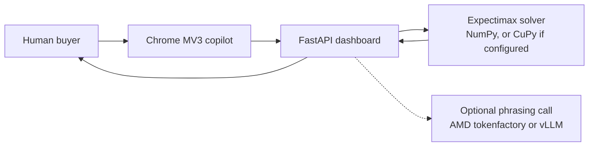

# TradeFlow AI

A one-person cross-border sourcing desk. A Bayesian Expectimax engine chooses the price. An optional language model only phrases the offer. A human sends it.

This is a hackathon prototype. It has not closed a deal with a real factory. Benchmark numbers below come from this repository's CPU runs or from a parameterised simulator. The full boundary note is [docs/LIMITATIONS_AND_REAL_WORLD_FINDINGS.md](docs/LIMITATIONS_AND_REAL_WORLD_FINDINGS.md).

Track: **Reinvent Commerce** (AMD Developer Hackathon ACT III, lablab.ai).

## Quick start (Docker)

```bash
git clone https://github.com/Fu93/tradeflow-ai.git
cd tradeflow-ai
cp .env.example .env
docker compose up --build
```

Open http://localhost:8000. `GET /health` is the compose and image healthcheck.

Leave the `__FILL_ME__` keys as they are. The dashboard, the solver, and the supplier-intent regex/ONNX stage run offline. The container listens on `0.0.0.0:$PORT` (compose publishes **8000**). The solver inside this image is **NumPy on CPU**. The compose file does not attach a GPU.

Without Docker:

```bash
pip install -r requirements.txt
python -m src.app.main
```

Chrome copilot (does not send messages): load `extension/` unpacked, or open `extension/mock_chat.html`.

```bash
python -m pytest tests -q
python -m src.cli            # one-supplier walkthrough
python -m src.cli --multi    # four-supplier auction
```

## Architecture



The solver updates a reserve-price belief and searches opening prices and concession curves. The Chrome extension shows a decision card. The buyer copies and sends. Nothing in the extension clicks Send.

## AMD integration

What is actually wired:

1. **Language endpoint.** Stage-2 intent classification can call an OpenAI-compatible API. `.env.example` points `VLLM_BASE_URL` at the AMD tokenfactory base `https://developer.amd.com.cn/radeon/api/v1`. A committed measurement is [results/real_llm_benchmark_100.json](results/real_llm_benchmark_100.json) (2026-10-15, model `Qwen3.8-Flash-Next`, 348 calls, average latency 16.81 s, cost about $0.108). That file is a past run, not a promise that the endpoint is up today.
2. **Check it yourself.** `python scripts/verify_amd_endpoint.py` writes `results/amd_endpoint_evidence.json`. With no key it records `skipped_no_credentials` and exits 0. That skip is not a successful check. Add `--chat` only when you are willing to spend tokens. The key is not written to the file.
3. **Solver backend, selectable.** `TRADEFLOW_SOLVER_BACKEND=numpy` (default) or `cupy` / `rocm` / `auto`. `cupy` requests CuPy and falls back to NumPy if the import fails. Explicit `use_gpu=True/False` still overrides the environment. Code: `src/engine/backend.py`, `src/engine/solver.py`.
4. **GPU-box benchmark.** On a machine with ROCm and CuPy:

   ```bash
   TRADEFLOW_SOLVER_BACKEND=cupy python scripts/benchmark_amd_gpu.py
   ```

   The same command runs on CPU. `ran_on_amd_gpu` is true only when CuPy sees a device name that looks like AMD. The MI300X HBM3 number in the output is an **estimate**: host working set divided by AMD's published 5.3 TB/s peak. It is not a runtime and not a speedup.

What this repository does **not** contain: a measured MI300X or other AMD GPU solve. [results/bench.json](results/bench.json) has `is_gpu_active: false`. Its `mi300x_transfer_lower_bound_seconds` values are the same kind of estimate. The development machine recorded for those figures is an Intel Core Ultra 7 355. [docs/deploy.md](docs/deploy.md) is a runbook for a future GPU box, not a log of a run that happened.

## Honest limits

- No closed-loop purchase. Supplier lines in the stress transcript are a script.
- Synthetic self-play ([results/self_play_benchmark.md](results/self_play_benchmark.md), 20 matches × 5 archetypes, seed 42) is a parameterised simulator. Engine savings in that table run from **8.8% to 20.0%**. Against the Hard-Bargainer the engine's 8.8% is behind the fixed 5%-per-round baseline's 9.2%.
- Held-out accuracy of the on-device intent model on the synthetic set is **63.08%** (195 of 500 held out). An older 92% figure was a training-set score.
- Stage-2 is off the request path by default because the recorded AMD calls take tens of seconds.
- The Evolus client is an optional email-draft adapter. The Evolus workflow was not created. This submission is not a second hackathon track.

Submission copy, a 3–5 minute demo script, and a slide outline: [SUBMISSION.md](SUBMISSION.md).

License: MIT.
