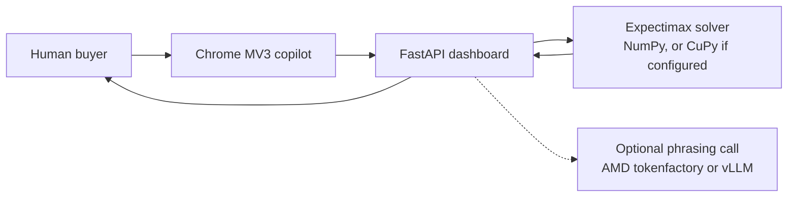

# TradeFlow AI

A one-person cross-border sourcing desk. A Bayesian Expectimax engine chooses the price. An optional language model only phrases the offer. A human sends it.

This is a hackathon prototype. It has not closed a deal with a real factory. Benchmark numbers below come from this repository's CPU runs or from a parameterised simulator. The full boundary note is [docs/LIMITATIONS_AND_REAL_WORLD_FINDINGS.md](docs/LIMITATIONS_AND_REAL_WORLD_FINDINGS.md).

Track: **Reinvent Commerce** (AMD Developer Hackathon ACT III, lablab.ai).

## Quick start (Docker)

```bash
git clone https://github.com/Fu93/tradeflow-ai.git
cd tradeflow-ai
cp .env.example .env
docker compose up --build
```

Open http://localhost:8000. `GET /health` is the compose and image healthcheck.

Leave the `__FILL_ME__` keys as they are. The dashboard, the solver, and the supplier-intent regex/ONNX stage run offline. The container listens on `0.0.0.0:$PORT` (compose publishes **8000**). The solver inside this image is **NumPy on CPU**. The compose file does not attach a GPU.

Without Docker:

```bash
pip install -r requirements.txt
python -m src.app.main
```

Chrome copilot (does not send messages): load `extension/` unpacked, or open `extension/mock_chat.html`.

```bash
python -m pytest tests -q
python -m src.cli            # one-supplier walkthrough
python -m src.cli --multi    # four-supplier auction
```

## Interface

The desk is set in self-hosted Fraunces and Outfit (SIL Open Font License) on a bone-paper palette. The four-supplier auction is the first panel. Each quote is drawn as a share of the walk-away ceiling returned by the auction API. The page still says the suppliers are simulated archetypes, and approval stays with the buyer.

`extension/mock_chat.html` is the same desk language used as a sandbox. It is not a live supplier site. The banner on that page says the quotes are simulated.

Screenshots:

- Desktop, before a run: [docs/screenshots/dashboard-desktop.png](docs/screenshots/dashboard-desktop.png)
- Mobile, before a run: [docs/screenshots/dashboard-mobile.png](docs/screenshots/dashboard-mobile.png)
- Auction panel before Run: [docs/screenshots/auction-before-desktop.png](docs/screenshots/auction-before-desktop.png), [docs/screenshots/auction-before-mobile.png](docs/screenshots/auction-before-mobile.png)
- Auction panel after Run: [docs/screenshots/auction-after-desktop.png](docs/screenshots/auction-after-desktop.png), [docs/screenshots/auction-after-mobile.png](docs/screenshots/auction-after-mobile.png)
- Full desk after Run: [docs/screenshots/dashboard-desktop-after-run.png](docs/screenshots/dashboard-desktop-after-run.png)
- Simulated supplier sandbox: [docs/screenshots/mock-chat-desktop.png](docs/screenshots/mock-chat-desktop.png), [docs/screenshots/mock-chat-mobile.png](docs/screenshots/mock-chat-mobile.png)
- Same desk at 360px and 768px: [docs/screenshots/dashboard-360.png](docs/screenshots/dashboard-360.png), [docs/screenshots/dashboard-768.png](docs/screenshots/dashboard-768.png). The mobile shot above is 390px. Desktop is 1280px.
- Circuit-breaker card with a long Traditional Chinese product name: [docs/screenshots/circuit-360.png](docs/screenshots/circuit-360.png)
- Extension side panel at 360px, with a long reference and a long price: [docs/screenshots/sidepanel-360.png](docs/screenshots/sidepanel-360.png)

## Architecture



The solver updates a reserve-price belief and searches opening prices and concession curves. The Chrome extension shows a decision card. The buyer copies and sends. Nothing in the extension clicks Send.

## AMD integration

Three buckets. They are not interchangeable.

**Verified.** A committed log, [results/real_llm_benchmark_100.json](results/real_llm_benchmark_100.json), records completed calls to the AMD tokenfactory base `https://developer.amd.com.cn/radeon/api/v1` (2026-10-15, model `Qwen3.8-Flash-Next`, 348 calls, average latency 16.81 s, cost $0.108444). That file does not store an HTTP status code. `python scripts/verify_amd_endpoint.py` writes `results/amd_endpoint_evidence.json`; `status: ok` means that process received HTTP 200. No evidence file is committed. `skipped_no_credentials` is not a successful check. The key is not written to the file.

**Estimated.** The MI300X numbers in [results/bench.json](results/bench.json) and [results/mi300x_roofline.json](results/mi300x_roofline.json) are a theoretical roofline lower-bound estimate, not measured. Formula: `lower_bound_seconds = (working_set_mb * 1024 * 1024) / (5.3e12)`. `working_set_mb` is the tracemalloc peak already stored on each `results/bench.json` row (`src/engine/benchmark.py:_measure_working_set_mb`, peak bytes / (1024 * 1024)). `scripts/regen_mi300x_roofline.py` rebuilds the JSON from those rows. It does not re-time the CPU. The denominator is the AMD Instinct MI300X datasheet figure "5.3 TB/s max. peak theoretical" (https://www.amd.com/content/dam/amd/en/documents/instinct-tech-docs/data-sheets/amd-instinct-mi300x-data-sheet.pdf). The same PDF says "Up to 192 GB HBM3". The product page repeats Peak Memory Bandwidth 5.3 TB/s and Dedicated Memory Size 192 GB (https://www.amd.com/en/products/accelerators/instinct/mi300/mi300x.html). Footnote MI300-18 on https://www.amd.com/en/products/accelerators/instinct/mi300.html writes 5.325 TB/s as `8192 bits * 5.2 Gbps / 8`; the estimate uses the datasheet's 5.3 TB/s. A host DDR speed is not in the datasheet and `results/bench.json` does not name a CPU, so no DDR ratio is stated.

**Not run.** This repository has no measured MI300X or other AMD GPU solve. [results/bench.json](results/bench.json) has `is_gpu_active: false`. `ran_on_amd_gpu` is true only when CuPy sees a device name that looks like AMD. [docs/deploy.md](docs/deploy.md) is a runbook for a future GPU box, not a log of a run that happened.

What is wired in code:

1. **Language endpoint.** Stage-2 intent classification can call an OpenAI-compatible API. `.env.example` points `VLLM_BASE_URL` at the tokenfactory base above.
2. **Solver backend, selectable.** `TRADEFLOW_SOLVER_BACKEND=numpy` (default) or `cupy` / `rocm` / `auto`. `cupy` requests CuPy and falls back to NumPy if the import fails. Explicit `use_gpu=True/False` still overrides the environment. Code: `src/engine/backend.py`, `src/engine/solver.py`.
3. **GPU-box benchmark.** On a machine with ROCm and CuPy:

   ```bash
   TRADEFLOW_SOLVER_BACKEND=cupy python scripts/benchmark_amd_gpu.py
   ```

   The same command runs on CPU. Read `ran_on_amd_gpu` as printed. The HBM3 column it prints is the theoretical roofline lower-bound estimate, not measured.

## Honest limits

- No closed-loop purchase. Supplier lines in the stress transcript are a script.
- Synthetic self-play ([results/self_play_benchmark.md](results/self_play_benchmark.md), 20 matches × 5 archetypes, seed 42) is a parameterised simulator. Engine savings in that table run from **8.8% to 20.0%**. Against the Hard-Bargainer the engine's 8.8% is behind the fixed 5%-per-round baseline's 9.2%. Seed 42 reproduces that table; it is not a variance estimate.
- The real-model log above is a different experiment. Against a Bluffing Hardliner the recorded deal rate is 61.11%, with 0 budget violations in 94 completed matches.
- Held-out accuracy of the on-device intent model on the synthetic set is **63.08%** (195 of 500 held out). An older 92% figure was a training-set score.
- Stage-2 is off the request path by default because the recorded AMD calls average 16.81 s.
- What was checked, and what was not: [docs/VERIFICATION.md](docs/VERIFICATION.md). `python scripts/check_claims.py` fails if a number in this file or in SUBMISSION.md drifts from its source, and if a doc states an MI300X figure that is not in `results/mi300x_roofline.json`.
- The Evolus client is an optional email-draft adapter. The Evolus workflow was not created. This submission is not a second hackathon track.

Submission copy, a 3–5 minute demo script, and a slide outline: [SUBMISSION.md](SUBMISSION.md).

License: MIT.
