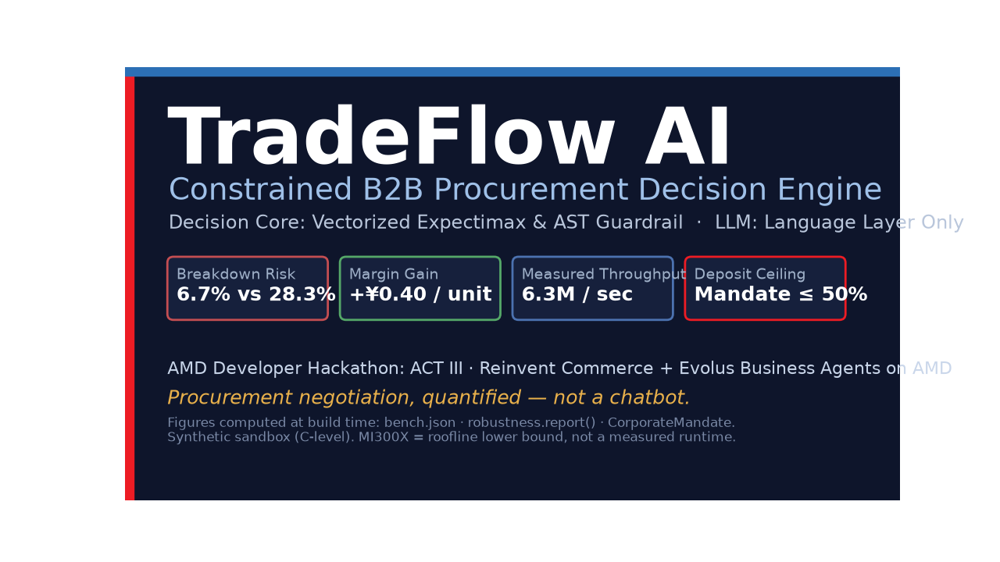
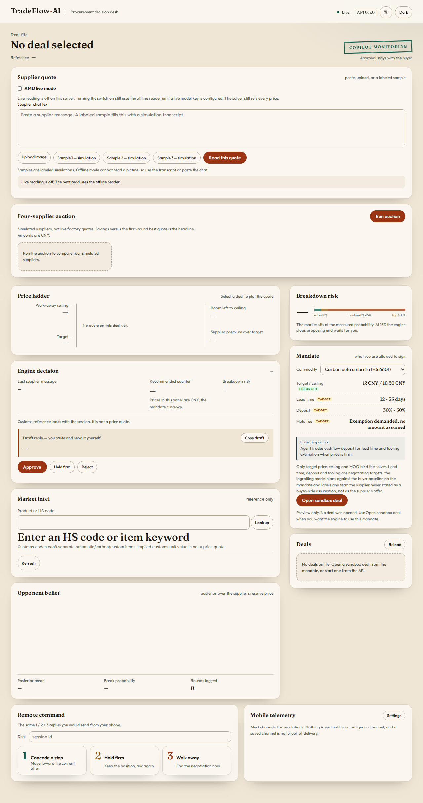
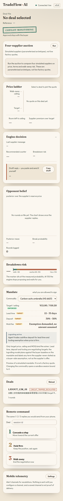
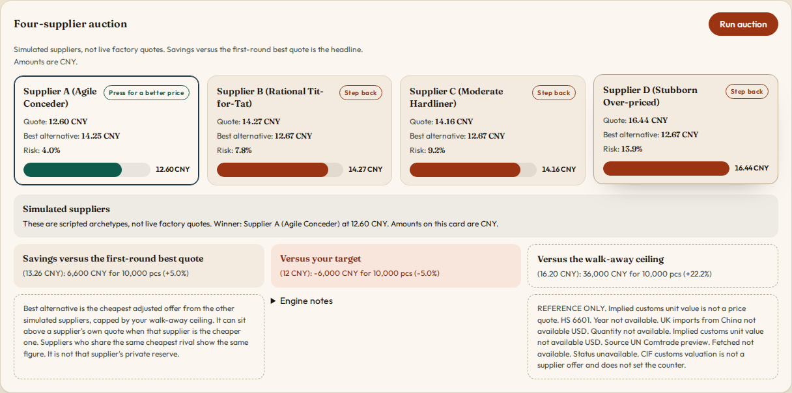
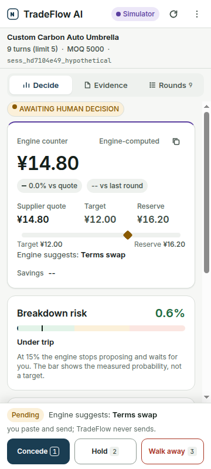

# TradeFlow AI

[](https://github.com/Fu93/tradeflow-ai/actions/workflows/ci.yml)

## Nebius x NVIDIA Global AI Hackathon entry

TradeFlow AI is a one-person supplier-negotiation desk for small cross-border sellers, entered in the **Nebius x NVIDIA Global AI Hackathon** (track Best Apps and Agents, plus the Best Use of Tavily bonus): a Nemotron model on Nebius Token Factory reads factory quotes, deterministic math prices the counter, and a person sends it.

Links: [Devpost text, judge steps and demo script](docs/DEVPOST_SUBMISSION.md) · [feedback on the tools](docs/NEBIUS_NVIDIA_FEEDBACK.md) · [public demo](#public-demo) · License: MIT <!-- DEMO_URL: final public demo URL --> <!-- VIDEO_URL: public YouTube link, 3 minutes or less -->

**How the three services are used.**

- **Nebius Token Factory** is the inference API (`api.tokenfactory.nebius.com/v1`) that serves the quote reader.
- **NVIDIA Nemotron** (Super by default; after any failed attempt the same model is tried once more; Ultra optional; all on Token Factory; an optional NVIDIA-hosted third hop is off in the demo) reads a supplier's free-text message and names the evidence spans in it: an offer, a fee, a deposit, a rival's price. The desk shows those spans and the model that read them.
- **Tavily** supplies a reference-only "Web evidence" card with cited public pages about a product or a supplier.

Code paths and tests are in [How this project uses Nebius, NVIDIA and Tavily](#how-this-project-uses-nebius-nvidia-and-tavily) below.

**Try it in two minutes** on the demo's `/desk` page:

1. **Fill a sample deal**, enter the API key (the judge key is in the Devpost testing instructions), **Open desk**. Four fictional suppliers.
2. **Use a sample message**, then **Add quote**. The waiting item shows which Nemotron model read it and the spans it labelled.
3. Pick the figure and **Accept**. Every confirmed quote recomputes all suppliers: ranking, default counter, push-lower counter, walk-away hazard. The paste form can also take freight, other fees and import duty per quote; the ranking then uses landed cost (see "Live supplier desk"). The sample message has none, so its ranking is by unit price.
4. **Use push lower in the draft** on a card, and **Check supplier on the web** (Tavily).
5. With the Chrome extension, tick **Read new supplier messages automatically**: new supplier messages on an open chat reach the desk by themselves.

**What the language model may and may not do.**

- It **may** read a quote and point at wording: it names a span and a class. It may optionally phrase a reply. As a second opinion it may point at one of the rule reader's own candidate figures as the supplier's offer; the desk pre-selects it only when the rules pre-selected none, and a person confirms.
- It **may not** supply a number, set, or change a price, or confirm a figure. A price field in its answer is discarded.
- The Bayesian reserve-price belief and the expected-surplus optimiser (a one-step lookahead) decide every counter, from quotes a person has confirmed.
- A human approves every send. The Chrome extension cannot press Send.
- Search results (Tavily) are shown as text beside the quote. No decision module reads them.

## Status (2026-10-28)

The repository began on 13 October 2026 as an entry for the AMD Developer Hackathon ACT III, which has concluded (online phase 12–18 October 2026). No lablab submission record for this project has been located. The AMD-era material is kept, not deleted, under [Earlier AMD Developer Hackathon build](#earlier-amd-developer-hackathon-build) near the end of this file, because `scripts/check_claims.py` checks its figures against source files. This is a **research prototype**: no factory has closed a deal through it. Current state and decision lines: [STATUS.md](STATUS.md). Where the code actually lives (including the `src/legacy/` naming inversion): [ARCHITECTURE.md](ARCHITECTURE.md).

## 30-second pitch

Small cross-border sellers lose procurement margin when they negotiate factory quotes alone, often across a language gap, or pay a sourcing agent a commission. TradeFlow is a one-person desk for that problem: expected surplus of a one-step accept-or-reject model chooses the next price, an optional language model only reads and phrases the offer, and a human sends it. No factory has closed a deal through this prototype.

The formulas, and the registry for every constant the decision code is allowed to use, are in [docs/MATH.md](docs/MATH.md). Benchmark numbers in this file come from this repository's CPU runs or from a parameterised simulator. The full boundary note is [docs/LIMITATIONS_AND_REAL_WORLD_FINDINGS.md](docs/LIMITATIONS_AND_REAL_WORLD_FINDINGS.md). The claim-by-claim check is [docs/DATA_INTEGRITY.md](docs/DATA_INTEGRITY.md).

The hackathon text and demo script are in [docs/DEVPOST_SUBMISSION.md](docs/DEVPOST_SUBMISSION.md).

## How this project uses Nebius, NVIDIA and Tavily

| Piece | Role at runtime | Code | Tests |
|---|---|---|---|
| **Nebius Token Factory** (`api.tokenfactory.nebius.com/v1`) | The OpenAI-compatible inference API that serves the quote reader | `src/desk/extract.py`, constants with rationales in `src/config/heuristics.py` | `tests/steps/test_extractor_failover.py`, `tests/steps/test_holdout_reader.py` |
| **NVIDIA Nemotron** (open models) | Reads a supplier message and names evidence spans with a class. The default is `nvidia/nemotron-3-super-120b-a12b` on Token Factory, with one retry of the same model; `TRADEFLOW_LLM_MODEL` selects another, such as `nvidia/Nemotron-3-Ultra-550b-a55b`. The dashboard's live reader (`src/engine/quote_read.py`) uses the same key and the Super model. Paid calls are capped per UTC day (`TRADEFLOW_LLM_DAILY_CALLS`, default from `LLM_DAILY_CALL_CAP`). A third hop on NVIDIA's hosted endpoint is **optional and off in the demo**: it opens only after Nebius itself fails (timeout, connection error, HTTP 429, HTTP 5xx, or a malformed body) and only when `NVIDIA_API_KEY` is set. Each hop has its own timeout (first hop 30 s, retry 20 s, optional NVIDIA hop 30 s) and the chain stops at a budget of 80 s (`src/config/heuristics.py`) | same | same |
| **Tavily Search API** | The "Web evidence" card on the dashboard: cited public pages about a product's wholesale prices and MOQ (`Market prices`) or about a supplier's reviews and complaints (`Check supplier`) | `src/market/web_evidence.py`, `GET /api/v1/market/evidence`, `src/web/static/js/web_evidence.js` | `tests/test_web_evidence.py` |

**How the model and the search are kept away from the price.** A price field in the model's answer is discarded. The amount is read by deterministic code from a span that occurs verbatim in the message, a second rule reader must agree before the shadow gate would accept anything, and a person confirms every number before it enters a decision. The model's second opinion can only point at one of the rule reader's own candidates. Search results are never read by a decision module: nothing in `src/engine`, `src/desk` or `src/legacy` imports the Tavily module, and `tests/test_web_evidence.py` fails if one does. Every Tavily payload is stamped `reference_only` and `influences_solver: false`, snippets are cleaned and shown as text only, and a search outage returns an explicit "unavailable" reason instead of an error. Lookups are cached and rate-limited per caller and per process to protect the search credits.

**Environment.** `TRADEFLOW_LLM_API_KEY` (the Nebius Token Factory key), `TRADEFLOW_LLM_MODEL` (optional model override), `TRADEFLOW_LLM_DAILY_CALLS` (paid calls per UTC day per server process, default 40; `0` turns them off), `NVIDIA_API_KEY` (optional third hop; off in the demo), `TAVILY_API_KEY`. With `TRADEFLOW_LLM_API_KEY`, `NVIDIA_API_KEY` and `TAVILY_API_KEY` all unset the app still runs offline: the rule reader prefills, nothing is accepted automatically, and the Web evidence card says it is not configured. `TRADEFLOW_WEB_EVIDENCE_OFFLINE=1` switches the card off even when a key is set.

**Not claimed.** The only accuracy measurement of the Nemotron reader is one small held-out test of 40 messages, not a benchmark; its numbers, weak spots and protocol are in "Honest limits" below and in [docs/QUOTE_READER_EVAL.md](docs/QUOTE_READER_EVAL.md). Latency is measured only in that run and in three single live reads. The committed latency log from the AMD era is for the AMD endpoint. The Tavily card shows what public pages say. It does not verify a supplier and it does not validate a price.

## What changed during the submission period

The first commit in this repository is dated 13 October 2026, after the submission period opened on 26 August. Through 26 October there were 124 commits, summarised round by round in [STATUS.md](STATUS.md): a keyed audit chain with signed human approval, named operator keys, deployment hardening, parser fuzzing with a ReDoS fix, and the split of the app layer. On 28 October, for this hackathon:

- the Tavily web-evidence card;
- the dashboard reader on Nemotron and Token Factory, with Super as the default model;
- the desk showing which model read each quote and the spans it labelled;
- the buyer's choice of the push-lower counter for a draft;
- a sample deal and a sample message;
- drafts that use the product name in the supplier's language;
- a daily cap on paid model calls;
- the reader's first-hop timeout (30 s) and a prompt that defines each label category (PR #31);
- freight, fees and duty fields on the desk's paste form, so the ranking can use landed cost (PR #32);
- the quote-reader evaluation on a small held-out set of 40 messages, recorded with its results files (PR #38; see Honest limits);
- the card shows the quote validity the supplier stated and flags an expired quote; it never moves the rank, counter or draft (PR #34). Not live-tested. A validity given in working days is shown as written and not turned into a date, and two contradictory validity statements are flagged as a conflict;
- when the model service refuses the key or the credit (HTTP 401, 402 or 403) the reader stops without a retry, pauses paid calls for 30 minutes (a restart clears the pause) and the desk says so and reads with the rules only (PR #35). Not live-tested;
- a model second opinion: when the model's own-offer label points at exactly one of the rule reader's candidate figures, the desk shows that the model agrees, or a disagreement if the rules read another figure. It pre-selects that figure only when the rules pre-selected none, it cannot add a number, and a person confirms every figure (PR #35). Not live-tested;
- a supplier's tier table: the desk pre-selects the row for your quantity, or warns when your order is below the smallest row; a person confirms (PR #35). Not live-tested;
- shows minimum order and lead time; flags a minimum order above your order without moving the ranking (PR #36). Not live-tested. Conflicting statements are shown as a conflict, and a lead time in working days is shown without a day count;
- a New deal button (PR #36). The button is present on the deployed `/desk` page; its behaviour is not live-tested;
- technical working lines (prior, reserve, sensitivity) are folded under "How these figures were worked out", and a landed-cost line appears only when it is complete (PR #36). Not live-tested;
- the rule reader reads a full-width full stop as a decimal mark and treats a dash rule around 转发 as the start of forwarded history (PR #33). Measured only on the same 40 messages, rules only, not held-out; not live-tested;
- a person can type the price when it is not a clean number in the message (for example 28塊5) and quote the words it came from (PR #39). The typed price is recorded as typed and shown on the card as typed by you. The amount is the person's own entry: the server checks that the quoted words appear verbatim in the supplier's message and that the amount is inside the deal's plausible price band, and it does not check that the amount agrees with those words (a live check on `ddc6567` accepted a typed 5 with the words `28塊5`; one observation). The send-time checks still compare the draft with the confirmed amount. Not live-tested beyond that one observation;
- chat suppliers such as `wechat:老王` or `whatsapp:+86…` need no email address. Their drafts are never emailed, even if SMTP is on: the approved text is copied and sent by the person (PR #39). Not live-tested;
- a deal currency of CNY, USD or EUR chosen on the form, with card amounts shown in it; a quote in another currency goes to review and the desk never converts (PR #39). Not live-tested;
- plain-language review reasons, with the reader's original reason kept in a tooltip and in the record (PR #39). Not live-tested;
- in the Chrome extension, a server choice, review inside the side panel, one key for every call, and the automatic read of new supplier messages.

The pull requests are #18 to #39.

**AI assistance.** The project's design, direction and trade-offs are the author's; AI coding tools (Cursor, Codebuff, Claude) assisted with writing code.
<!-- TODO(owner): confirm that you reviewed the decision logic and tests before keeping the sentence "all decision logic and tests were reviewed by the author" -->

## What is proven

Each desk step has a guard, a test, and a chain record. A failed check withholds the counter. The language model does not set a price. A person approves every send.

| Step | Guard | Test | Record |
|---|---|---|---|
| T1 Intake | `QuoteIn` extra=forbid; currency from the deal; `raw_sha256` on the event; status stays `review` | `tests/steps/test_t1_intake.py` | `quote_ingested` |
| T2 Extract | `Mention` extra=forbid; numeric price keys stripped; byte cap; the call does not block the desk; fail closed | `tests/steps/test_t2_extract.py` | `extractor_result` |
| T3 Shadow | would-accept is recorded; `applied` and `auto_accept` stay false | `tests/steps/test_t3_shadow.py` | shadow fields on the quote provenance |
| T4 Confirm | `review` may become `accepted` or `rejected`; both of those are terminal | `tests/steps/test_t4_confirm.py` | `review` |
| T5 Reserve | truncated Beta; a later higher ask does not raise the mean; a rejection is a lower bound | `tests/steps/test_t5_reserve.py` | prior alpha, beta, n, source on the decision record |
| T6 Hazard | one module, `src/engine/hazard_fit.py`; increment is 0 at the ask | `tests/steps/test_t6_hazard.py` | `hazard_fit_sha256` on the decision record |
| T7 Optimiser | desk calls `decision.choose_offer` only; sample and grid budgets are not inputs | `tests/steps/test_t7_optimiser.py` | optimiser name on the decision record |
| T8 Draft | pure decide, then `project_open_drafts`; body contains the issued counter | `tests/steps/test_t8_draft.py` | `decision`, then `draft_created` |
| T9 Send | human approval; `_guard_send` re-derives the counter from the stored record | `tests/steps/test_t9_send.py` | `send_approved`, `send_result` |
| T10 Audit | HMAC-SHA256 chain keyed by `TRADEFLOW_CHAIN_KEY`; append-only; verify endpoint reports `anchor not configured` when no anchor is set | `tests/steps/test_t10_audit.py` | `GET /api/v1/desk/deals/{id}/audit/verify` |
| T11 Release | ruff, mypy, 90% phase-1 coverage, hash-pinned locks, pip-audit | `.github/workflows/ci.yml` | CI log |

| Evidence tier | What it covers |
|---|---|
| Live | `python scripts/desk_verify.py <base-url>` creates a deal, ingests a fixture email, confirms it, checks the chain, refuses a send without approval, then approves. Exit 0 means every check passed. |
| Test | `python -m pytest tests` plus `python scripts/mutation_sanity.py` (30 planted bugs in `decision.py`, `reserve.py`, and `shadow.py`). |
| Fixture | `data/hazard_ebay_bi.json` is the fitted walk-away file. The reserve prior is labelled policy until this supplier has enough of their own responses. |
| Not claimed | No factory has closed a deal through this prototype. The eBay fit is not a Chinese factory rate. `/round`, `/negotiate`, and the v1 engines stay in `src/legacy/` and mount only when `TRADEFLOW_LEGACY=1`. |

Code freeze after 27 Oct 2026 for the decision formula: `src/engine/decision.py`, `src/engine/reserve.py` and `src/engine/hazard_fit.py` are unchanged since 26 Oct (checked with `git diff` against commit `dbf8298`). On 28 Oct, owner-approved hackathon features were added around it: the Tavily web-evidence card, the Nemotron readers and their trace on the desk, a sample deal and message, a daily cap on paid model calls, drafts in the supplier's language, the extension's automatic read, and a desk feature where a person picks which figure goes into a draft (the default or the push-lower counter). That choice is a human event on the audit chain, and the send guard re-derives the figure from the chain at send time (`src/desk/decide.py`, `recompute.py`, `verify.py`, `service.py`). The desk card's `hazard_upper` now shows the hazard at the push-lower figure.

Internal notes, filming guides, and older audits are indexed in [docs/internal/README.md](docs/internal/README.md).

Desk environment variables (unset means the feature stays off, except the database path and the poll interval):

`TRADEFLOW_API_KEY` `TRADEFLOW_LEGACY` `TRADEFLOW_DESK_DB` `TRADEFLOW_STORE_DIR` `DESK_N_SAMPLES` `DESK_N_GRID` `DESK_SMTP_SEND` `SMTP_HOST` `EMAIL_USERNAME` `EMAIL_PASSWORD` `IMAP_HOST` `IMAP_PORT` `IMAP_SSL` `IMAP_USERNAME` `IMAP_PASSWORD` `IMAP_LOOKBACK_DAYS` `IMAP_POLL_SECONDS` `GMAIL_DRAFTS` `GMAIL_CLIENT_ID` `GMAIL_CLIENT_SECRET` `GMAIL_REFRESH_TOKEN` `TRADEFLOW_LLM_BASE_URL` `OPENAI_BASE_URL` `TRADEFLOW_LLM_MODEL` `OPENAI_MODEL` `TRADEFLOW_LLM_API_KEY` `OPENAI_API_KEY` `NVIDIA_API_KEY` `TRADEFLOW_EXTRACTOR_TIMEOUT_ULTRA` `TRADEFLOW_EXTRACTOR_TIMEOUT_SUPER` `TRADEFLOW_EXTRACTOR_TIMEOUT_NVIDIA` `TRADEFLOW_EXTRACTOR_TIMEOUT_BUDGET` `TRADEFLOW_CHAIN_KEY` `TRADEFLOW_CHAIN_KEY_ID` `TRADEFLOW_CHAIN_KEYS` `TRADEFLOW_CHAIN_ANCHOR`

The audit chain is HMAC-SHA256 with `TRADEFLOW_CHAIN_KEY`. The key is not stored in the database. Desk sends refuse to start when that variable is unset, and `GET /health` reports `desk sends disabled: chain key missing`. `TRADEFLOW_CHAIN_KEY_ID` names the current key (default `primary`). `TRADEFLOW_CHAIN_KEYS` is a comma-separated `id:secret` list of retired keys so older rows still verify after a rotation. A chain written by the round-5 code has an empty `key_id`. Its MAC is HMAC-SHA256 of `{deal_id, seq, type, ts, payload, prev_hash}` with the current key, and verify accepts those rows in place. They are not re-signed. A round-5 row has no key id, so a rotated key does not verify it; restoring `TRADEFLOW_CHAIN_KEY` to the key that signed it does. An intact pre-key SHA-256 chain is a different object and is not verified as HMAC.

Opening the database does not migrate. `POST /api/v1/desk/deals/{id}/migrate` with `human_confirmed: true` is the only migration. It refuses a deal that already has a keyed chain (including a round-5 chain) or an anchor head, and it does not overwrite that head. An intact pre-key chain is archived as `legacy unverified` and a new keyed chain starts at genesis. A deal with no chain rows gets one migrated head. Accepted quotes return to review. A migrated deal cannot be sent until a person re-confirms each quote and, after the migration mark, appends a human `supplier_address` for every supplier that was already on the deal and a human `policy_confirmed` event (`POST /api/v1/desk/deals/{id}/policy`) for the product, quantity, target, ceiling, risk, and currency. Policy confirmation is only for a migrated deal. The chain payload records the previous limits. A supplier row that was not in that opened list is flagged on the card and is not a rival until `POST .../suppliers/{id}/keep` with `human_confirmed: true` and an address typed on that request appends `supplier_kept`. Keep is only for a migrated deal and only for a flagged supplier. The chained address is that request, not the supplier row.

When `TRADEFLOW_CHAIN_ANCHOR` is a file path or an http(s) URL, each new head (sequence and MAC), including each approval and each transmission result, is written there after the database row. The file index is replaced atomically (temp file, fsync, rename). A matching index is one seek of that deal's latest line, so verify does not read the whole log. Each anchor record carries an HMAC-SHA256 chain of every exported head and every exported approval, signed with the chain key, so a URL anchor that stores only its latest body still returns that chain. A missing or rewritten chain is not evidence that an approval was never exported, and another approval is refused until `POST /api/v1/desk/deals/{id}/anchor-history/recover` with `human_confirmed: true`. That recovery is refused while the chain still verifies, so it cannot drop a recorded approval. A file beside the desk database is not the record of what was exported. A missing or mismatched index is scanned for the deal being read, and only a deal with no valid line fails closed. If that write fails, the deal is marked pending and verification fails closed with `anchor missing because the anchor store was down`. The pending mark stays until a re-anchor export succeeds. Saving another event does not clear it. A send whose anchor write failed does not release the mail, and the draft stays unsent. After a re-anchor that does not shorten the chain, that same draft can be approved once more, and only when the anchor history never recorded that approval. A recorded approval is a duplicate, including when the database rows after it were removed. Deleting the unanchored chain row does not make a resend succeed while the pending mark remains. `POST /api/v1/desk/deals/{id}/reanchor` with `human_confirmed: true` appends a chained `reanchor` event only when the links verify and every recorded anchor head is still in the chain. A missing head is `anchor missing because the chain was cut`, and re-anchor refuses with possible truncation. An anchor store that errors is the down phrase, and re-anchor refuses that too, without writing a new head. A missing anchor file or a missing deal line also fails verification when an anchor is configured, and re-anchor will not sign over that gap. If `TRADEFLOW_CHAIN_ANCHOR` is unset, verify reports `anchor not configured`, and tail truncation is detectable only with an anchor. A deploy that changes policy constants marks the open draft stale: the desk writes a new draft and the old approval does not send. A clause with a primary price plus a parenthetical conversion, such as a CNY amount and `about USD`, keeps the primary currency. A bare primary amount followed by a cued parenthetical in another currency stays unconfirmed: the parenthetical amount is not the price, and the unlabelled primary is only a prefill. A parenthetical price in the same currency, such as a rebate, stays unconfirmed. `31.00 dollars or yuan` stays unconfirmed. The quote parser is warmed at startup so the one-time pattern cost is outside the match deadline. A match that passes the deadline still fails closed.

A supplier who walks away is not a rival and gets no new counter. A later quote does not put them back. A person re-opens them with `POST /api/v1/desk/deals/{id}/suppliers/{supplier_id}/reopen` and `human_confirmed: true`, which appends a chained `reopen_supplier` event. The draft card and the send guard use one reserve-aware decision, so a walk-away, a re-open, and a new quote produce the same counter in both places. A changed email is the same kind of action: `POST .../address` with `human_confirmed: true` appends `supplier_address`. The address has to be one addr-spec; a list, a display name, or a CR/LF is rejected when the deal or the address is saved. A control character in the product is rejected at the same time, before it can become the subject. The send uses the chained id, name, and address, the chained product in the subject, and the chained In-Reply-To and References. Inbound `Message-ID` and `References` values are reused only when each token is one message-id. Those fields and the body are hashed together. An amount written as `31.00 dollars` is USD. If the same clause also names another currency, the amount stays unconfirmed.

## Quick start (Docker)

```bash
git clone https://github.com/Fu93/tradeflow-ai.git
cd tradeflow-ai
cp .env.example .env
docker compose up --build
```

Open http://localhost:8000. `GET /health` is the compose and image healthcheck.

Leave the `__FILL_ME__` keys as they are. The dashboard, the solver, and the supplier-intent regex/ONNX stage run offline. The container listens on `0.0.0.0:$PORT` (compose publishes **8000**). The solver inside this image is **NumPy on CPU**. The compose file does not attach a GPU.

Without Docker (use `python3` if `python` is not on your PATH):

```bash
python -m pip install -r requirements.txt
python -m pip install -r requirements-dev.txt  # pytest, ruff, mypy; not the runtime image
python -m src.app.main
```

Open http://localhost:8000. If port 8000 is already taken, the process prints that and exits. Start on another port with `PORT=8001 python -m src.app.main` (the suggestion in the message names the interpreter you actually ran).

Chrome copilot (does not send messages): load `extension/` unpacked, or open `extension/mock_chat.html`. No API key is required for this offline demo. Placeholder values in `.env.example` stay `__FILL_ME__`.

```bash
python scripts/preflight.py  # before a recording; prints FIX lines, never secret values
python -m pytest tests -q
python -m src.cli            # one-supplier walkthrough
python -m src.cli --multi    # four-supplier auction
```

The video script for this hackathon is in [docs/DEVPOST_SUBMISSION.md](docs/DEVPOST_SUBMISSION.md). [docs/DEMO_RUNBOOK.md](docs/DEMO_RUNBOOK.md) is the click-and-narration script written for the earlier AMD-era build and is not updated for this entry. Form fields for the earlier lablab (AMD) entry: [docs/LABLAB_FORM.md](docs/LABLAB_FORM.md). The slide deck, built for that earlier entry, is [results/pitch.pptx](results/pitch.pptx) and [results/pitch.pdf](results/pitch.pdf) (nine slides, rebuilt from the SUBMISSION.md outline).



## Human + AI workflow

Hybrid desk. The model reads a supplier message and may phrase a reply. The solver sets every number. The human copies the draft and sends it. The Chrome extension cannot press Send.

## Market and business

Target user is a hypothesis: a small cross-border seller who sources from factories and negotiates in chat.

HMRC counted 334,294 UK goods importers in 2025. The non-EU SAM proxy is 132,484 to 239,616. UK goods imports from China were GBP 69.7 billion in 2025 (ONS/DBT), including precious metals and large corporates. The savings-pool ceiling of GBP 1.05 billion to GBP 2.09 billion uses a large-buyer 1.5 percent to 3 percent band. It is not a TradeFlow result. Citations, the formula, and the HS snapshot are in [docs/MARKET_ANALYSIS.md](docs/MARKET_ANALYSIS.md).

Umbrellas (HS 6601) are the demo wedge. `scripts/market_data.py` and `GET /api/v1/market` read the UN Comtrade preview for other codes. Creating a session attaches `market_context` (or an explicit unavailable state). The engine-decision card, the extension Evidence tab, and the auction summary show it as reference only: an implied customs unit value, not a price quote. The solver, the recommended price, and the circuit breaker do not read it. `tests/test_market_data.py` checks that the recommended price is identical with and without a caller-supplied block, and that a model JSON cannot set the price.

Revenue model, proposed and not earned: a desk subscription, or a share of savings versus the first-round best quote. No revenue is claimed.

Competitors with a public price: Accio and Alibaba RFQ (free for buyers). Pactum, Keelvar, Fairmarkit, Jaggaer, Zycus, and Globality are quote-based.

## Public demo

[render.yaml](render.yaml) matches the live Docker web service `tradeflow-ai-demo` in Frankfurt (`https://tradeflow-ai-demo.onrender.com`), instance type 0.5 CPU / 512 MB, health check `GET /health`, offline by default. `WEB_CONCURRENCY` is `1`. `TRADEFLOW_ENV` is `production`, so webhooks fail closed when `TRADEFLOW_WEBHOOK_TOKEN` is unset. `TRADEFLOW_LEGACY` is `0`. `TRADEFLOW_CHAIN_ANCHOR`, `TRADEFLOW_DESK_DB`, and `TRADEFLOW_CHAIN_KEYS` are listed with `sync: false` (blank until set in the dashboard). Other secrets are `sync: false` so a Blueprint sync does not overwrite them: `VLLM_API_KEY`, `EVOLUS_API_KEY`, `EVOLUS_APP_ID`, `TRADEFLOW_API_KEY`, `TRADEFLOW_CHAIN_KEY`, `TRADEFLOW_CHAIN_KEY_ID`, `TRADEFLOW_WEBHOOK_TOKEN`, `TRADEFLOW_LLM_API_KEY`, `NVIDIA_API_KEY`, and `TAVILY_API_KEY`. The file does not set `PORT`; Render injects it and the process binds `0.0.0.0:$PORT`. The filesystem is ephemeral, so `TRADEFLOW_DESK_DB` and a file anchor do not survive a restart unless a disk is attached.

**Approval and sending on the demo.** On 2026-10-28, with the owner's approval, the demo service got `TRADEFLOW_REQUIRE_SIGNED_APPROVAL=0` in the Render dashboard (the only variable changed; `render.yaml` does not set it, and `/ready` now reports `signed_approval: policy=optional`). The live demo therefore accepts an unsigned **Approve and send** click. No SMTP is configured on the demo, so no email is ever sent: an approved draft shows status approved and `transmitted: 0`. One single check on master `14df25a` (one observation, not a benchmark): approve returned HTTP 200 unsigned, the draft was approved, transmitted was 0, and the audit chain verified with 14 entries. That check predates PRs #35 and #36. Real use requires a pinned approver public key, signing with `python -m src.desk.approval_signing`, and an SMTP configuration. The price is always confirmed by a person, and the model's labels are a second opinion only. The chain is verified from the audit line, from `GET /api/v1/desk/deals/{id}/audit/verify` on `/docs`, or with `scripts/desk_verify.py` (there is no verify button).

## Interface

The desk is set in self-hosted Fraunces and Outfit (SIL Open Font License) on a bone-paper palette. The supplier quote sheet is the first panel. The four-supplier auction follows it. Each quote is drawn as a share of the walk-away ceiling returned by the auction API. The page says the suppliers are simulated archetypes, and approval stays with the buyer.

The auction headline is savings versus the first-round best quote. In the committed run ([results/multi_supplier_auction.md](results/multi_supplier_auction.md)) that is ¥13.26 down to ¥12.60, which is 5.0% and ¥6,600 on 10,000 units. Versus target is on the same panel, including when that figure is negative (this run is −5.0% versus the ¥12.00 target, ¥−6,000). Savings versus the walk-away ceiling, 22.2% and ¥36,000, are secondary and labeled as such. Those three baselines are not interchangeable with the self-play range in Honest limits.

`extension/mock_chat.html` is the same desk language used as a sandbox. It is not a live supplier site. The banner on that page says the quotes are simulated.

Screenshots:









- Desktop, before a run: [docs/screenshots/dashboard-desktop.png](docs/screenshots/dashboard-desktop.png)
- Mobile, before a run: [docs/screenshots/dashboard-mobile.png](docs/screenshots/dashboard-mobile.png)
- Auction panel before Run auction: [docs/screenshots/auction-before-desktop.png](docs/screenshots/auction-before-desktop.png), [docs/screenshots/auction-before-mobile.png](docs/screenshots/auction-before-mobile.png)
- Auction panel after Run: [docs/screenshots/auction-after-desktop.png](docs/screenshots/auction-after-desktop.png), [docs/screenshots/auction-after-mobile.png](docs/screenshots/auction-after-mobile.png)
- Full desk after Run: [docs/screenshots/dashboard-desktop-after-run.png](docs/screenshots/dashboard-desktop-after-run.png)
- Simulated supplier sandbox: [docs/screenshots/mock-chat-desktop.png](docs/screenshots/mock-chat-desktop.png), [docs/screenshots/mock-chat-mobile.png](docs/screenshots/mock-chat-mobile.png)
- Same desk at 360px and 768px: [docs/screenshots/dashboard-360.png](docs/screenshots/dashboard-360.png), [docs/screenshots/dashboard-768.png](docs/screenshots/dashboard-768.png). The mobile shot above is 390px. Desktop is 1280px.
- Circuit-breaker card with a long Traditional Chinese product name: [docs/screenshots/circuit-360.png](docs/screenshots/circuit-360.png)
- Extension side panel at 360px, with Decide, Evidence, and Rounds and the approval bar along the bottom: [docs/screenshots/sidepanel-360.png](docs/screenshots/sidepanel-360.png)

## Architecture


The solver updates a reserve-price belief and searches opening prices and concession curves. The Chrome extension shows a decision card. The buyer copies and sends. Nothing in the extension clicks Send.

The "Optional phrasing call" box in this diagram is the earlier AMD-era endpoint. The Nemotron quote reader that this hackathon entry is about runs in desk intake (`src/desk/extract.py`) and only names evidence spans; it is not drawn here.

## Live supplier desk

A deal keeps four or five supplier threads in SQLite (`TRADEFLOW_DESK_DB`, or `desk.db` under `TRADEFLOW_STORE_DIR`, or `data/desk.db`). Each quote stores its source (`email`, `chat-import`, or `paste`), the raw text, the parsed fields, the time, and provenance. An accepted quote updates that supplier's reserve belief from the full accepted history and runs the coupled solver again. The page at `/desk` polls the snapshot. The same snapshot is available as a server-sent stream for a client that can send the API key.

The paste form on `/desk` has optional freight, other fees and import duty fields (freight and fees per unit in the deal currency; duty as a percent). They go in together or not at all: all three filled (0 counts as a value) or all three blank, and a partly filled set is refused by the form. A blank is "no data", never zero. When every quoted supplier has all three, the ranking uses landed cost instead of the unit price (`ranking_basis` is `landed_cost`, otherwise `unit_price`), and the send-time check recomputes the counter the same way. This is covered by unit tests and CI (`tests/test_desk_landed_inputs.py`); the form has not been tried live with a real quote.

Mailbox intake leaves the seen flag alone. IMAP opens the inbox with EXAMINE and reads with BODY.PEEK. `IMAP_LOOKBACK_DAYS` (14) is the window, including mail that is already read. A message is remembered only after it is stored on a deal, keyed by that deal plus UID and Message-ID, so a wiped database can scan the window again. Mail that matches no deal, and a quote that arrives before its deal exists, stays in the window for a later poll. A poll for one deal does not hide another deal's mail. Mail whose sender is not a supplier on the deal is not stored.

- IMAP: `IMAP_HOST`, `IMAP_PORT` (993 with SSL), `IMAP_USERNAME`, `IMAP_PASSWORD`, `IMAP_SSL` (1), `IMAP_POLL_SECONDS` (60), `IMAP_LOOKBACK_DAYS` (14). The poller starts only when host, username, and password are all set. Login uses TLS with the default certificate check. Plain IMAP is only the loopback test fixture. A non-loopback host without TLS is refused. The poll route does not accept a host, port, or password from the request. Gmail app passwords use IMAP with SSL.
- Gmail API, optional: `GMAIL_CLIENT_ID`, `GMAIL_CLIENT_SECRET`, `GMAIL_REFRESH_TOKEN`. Ingestion lists recent mail and reads it without marking it read. `GMAIL_DRAFTS=1` creates or replaces a Gmail draft. The desk does not call the send method.
- A reply is a draft in the supplier's language, English or Chinese, taken from their messages. It carries In-Reply-To, References (the earlier References plus the parent Message-ID), and its own Message-ID. It does not include engine notes. Approval is the hash of that exact text. A newer quote replaces the draft, and the previous approval no longer sends. A counter that is withheld withdraws the open draft. A draft that was already sent is not created again, and approving it does not send a second copy. A failed send can be approved again. `DESK_SMTP_SEND=1` together with `SMTP_HOST`, `EMAIL_USERNAME`, and `EMAIL_PASSWORD` is what hands that approved text to SMTP. The send runs off the request thread with a timeout. A failed attempt is stored as failed. Without the flag, approval stays on this desk and the text is left to copy. Nothing is sent from ingest, from a poll, or from the extension.

Every desk route, including the snapshot and the event stream, requires `TRADEFLOW_API_KEY` in every mode, including sandbox. The sandbox demo token does not open the desk.

Every ingested number stays in review until a person confirms it. The decision reads only accepted events. A posted `/round` or `/negotiate` price is not a confirmation: the server does not stamp it as accepted by a person, and the counter comes from the desk confirm flow. Raw text alone is rejected and is not a price. The audit line is `unconfirmed numbers used in decisions: N`, and N is counted from the provenance of the numbers that decision consumed. An optional extractor may name an evidence span and a class. It does not set a price. A malformed extractor response fails closed and the quote stays in review. Deterministic code reads the amount from a span that occurs verbatim in the message. A rule reader is the second opinion, and it does not share that tokenizer. The agreement gate only logs what it would have accepted. Phase 1 does not auto-accept. A rejected shadow-accept counts as a disagreement. An instruction mention on a span blocks that span. The desk shows how many of those shadow accepts the user later confirmed unchanged, toward 189, which is the two-sided Wilson sample size at which zero errors put the 95% lower bound at 0.98. Without an extractor endpoint, the rule reader prefills and the gate does not accept. Unknown senders are not stored.

The Chrome extension adds a Desk tab. The API key is typed there and stored in the extension; a missing or rejected key is reported as a key error. One click, or Alt+Shift+I, imports the supplier message that is visible in the open chat. A shop name or a contact name matches as a whole phrase, and a unique match picks that thread. A page that matches several suppliers asks for a choice among those matches. A page that matches nobody asks for a choice, and that choice applies only on that page. The mock chat page is labelled simulated, and that import stays in review until a person accepts a figure from the text. The import does not crawl, type, or press Send. A visible captcha pauses it. The panel shows the ranking, the default counter, the push-lower counter, the hazard, and a draft to copy.

The default counter matches the best other confirmed landed quote, and it never exceeds this supplier's ask or the user's ceiling. When this supplier is already the cheapest, the default is their own ask. The model's push-lower counter maximises expected landed-cost saving minus the incremental walk hazard on that interval. The maximiser is a closed form or a bounded golden-section search. A mesh step is not an input. Samples fill the reported tail and do not pick the price. A tighter rival can lower a counter and cannot raise one. This is a per-round heuristic: other quotes are treated as fixed and recallable, and the offer is not an exact multi-round equilibrium.

The reserve is the supplier's first ask times `D`, with `D` in `[0, 1]` and a Beta prior of its own. The latest ask caps the offer and does not rescale `D`. Another supplier's ask is not used. A typed markup is not applied. A later ask, an acceptance, and a closed deal are upper bounds on `D`. A rejection is a lower bound. The posterior is that Beta truncated to the interval, in closed form. The card shows the prior mean and strength, labelled user policy, and those two inputs are what the decision uses. It shows the push-lower counter at half the prior strength and at double it, with the mean held fixed. The walk penalty is the incremental hazard times the surplus at stake, not the full outside price. A push whose expected value is negative is withheld. The walk-away hazard is the quote gap plus a small-gap hinge, transferred from the seller-ended eBay Best Offer fit for Business & Industrial in 2012–13. The fit is the first buyer offer of a thread and is applied per round to the latest ask. It is not a measured Chinese-factory rate. The hinge peaks at a zero gap, so it is not the increment the risk cap uses. The cap uses the gap slope with the hinge held at zero, and a tighter cap can withhold a push. The published coefficients are unchanged. An offer at the ask has incremental hazard 0. The fit script runs offline and is not part of the Render service. For a real closed deal, the headline compares landed with landed. A simulated or fixture deal is labelled and is not counted.

Tests cover an in-process IMAP server, the mock chat import, the price and approval gates, and the resident set of a five-supplier update. That test prints the resident set and the elapsed time; this file does not copy them.

On Render's free plan the disk is ephemeral, so `TRADEFLOW_DESK_DB` does not survive spin-down unless a disk is attached. The desk is built to stay inside the same 512 MB instance as the rest of the app.

## Honest limits

- *Proven in this repository (2026-10-28):* the decision core, the audit chain, the fail-closed quote-reading gates and the Tavily card are covered by tests that run offline or with fakes (see "What is proven" above). The request path to Token Factory and the Nemotron failover chain are in code and tested with fake endpoints.
- *Checked live, three times, one quote read each (not benchmarks):* on 2026-10-28 (1) the Token Factory quote reader and the Tavily call were each exercised once on the demo with the Ultra default of that time; (2) one sample message was read on Super (`nvidia/nemotron-3-super-120b-a12b`) before any prompt change: the first attempt timed out at the then 12.0 s limit, the retry succeeded in 11.2 s, and the model labelled the supplier's own "我们正品单价 27.80 元/把" as `our_price_echo`, not `own_unit_offer` (a mislabel; its "隔壁厂给你 24 元那是次料" as `rival_price` was right); (3) after PR #31, the same sample message was read once more on Super with exactly one attempt (12.26 s, status ok, no timeout or retry), and this time 27.80 was labelled `own_unit_offer`. In every run the quote went to human review ("more than one price", a reason from the deterministic rule reader seeing two prices, not from a model label), no draft or counter was created, and the amount comes from the deterministic reader. What changed between (2) and (3): the extraction prompt now defines each label category (including that a price said right after a rival's price is the supplier's own offer), and the first-hop timeout is 30 s, the retry 20 s and the chain budget 80 s (were 12 s, 15 s and 57 s). Only this one sample was re-checked. The sample resembles two held-out evaluation items that the change exposed, so (3) is not a held-out result; it is one observation, not an accuracy or latency measurement. Details: "Single live check" in [docs/DEVPOST_SUBMISSION.md](docs/DEVPOST_SUBMISSION.md).
- **A small held-out test (40 messages), not a benchmark.** On 2026-10-28 we ran 40 short supplier messages written for this test through the rule reader and through Nemotron Super (`nvidia/nemotron-3-super-120b-a12b`, one run, [docs/QUOTE_READER_EVAL.md](docs/QUOTE_READER_EVAL.md), results in `results/quote_reader_eval.json`). They are original sentences, not real supplier mail, and the labels are the author's own reading. 22 messages carry one current CNY unit offer; 18 should be left for a person. Rules: 14 correct, 2 wrong, 7 missed (sent to review), 17 held for a person. Super alone, with the amount read by code from the span the model labelled as the supplier's own offer: 20 correct, 2 wrong, 2 missed, 16 held. The desk's gate (rules and model must agree): 14 correct, 1 wrong, 8 missed, 17 held. One call per message took a median of 3.9 s and at most 8.3 s. Two of the messages (`zh_rival_then_own`, `en_rival_then_own`) are exposed items: they resemble the sample that led to the prompt change in PR #31, so they are not clean for the model. Without them (38 messages): rules 14/2/5/17, Super alone 18/2/2/16, gate 14/1/6/17 (correct/wrong/missed/held). **Weak spots.** A forwarded old quote (`zh_forward_old`, 31.00) was read as the current offer by the rules and by the model, so the gate was wrong on it too. The rules read full-width `２８．５０元` as 50. Super alone also read a price with no currency (`en_no_currency`, 27.5) that should have been left for a person; the desk's gate adds currency and per-piece tests that this script does not apply, and how often they would have stopped it was not measured. **What PR #33 changed.** The rules now read a full-width full stop as a decimal mark and treat a dash rule around 转发 as the start of forwarded history. The rules-only re-run after that fix is 15 correct, 0 wrong, 7 missed, 18 held ([results/quote_reader_eval_rules_after_fix.json](results/quote_reader_eval_rules_after_fix.json)). That figure is not held-out, because the two fixes were made after looking at two items of this set; it is the rules only, with no new model run, and the model's column above is unchanged. The model alone still reads the forwarded 31.00; on the desk a person confirms.
- *Not yet proven:* that the reader generalises beyond that small test (40 invented messages, one run of one model, no real supplier mail), latency beyond these single calls and that run, and that the label is stable across messages. No accuracy or latency benchmark is committed, and none is claimed here. No factory has closed a deal through this prototype.
<!-- Live run 1 (single check, Ultra, not a benchmark): 2026-10-28 about 12:17 London (UTC), live demo https://tradeflow-ai-demo.onrender.com running master commit 5c0321830e5cadb7a4571fbe9ca46fe510017895. Nebius Token Factory: one sample quote (fictional example.test suppliers); recorded extractor attempt: provider nebius, model nvidia/Nemotron-3-Ultra-550b-a55b, status ok, latency 1.83 s (one call). That run used Ultra because it was the default of master 5c03218 at the time. Tavily: GET /api/v1/market/evidence?kind=market&product=... returned HTTP 200, status ok, 5 results, about 2.3 s (one call). -->
<!-- Live run 2 (single check, Super, before the prompt change, not a benchmark): 2026-10-28, demo on master 10868aa, one sample deal and one pasted sample message to supplier A. Provider Nebius Token Factory, model nvidia/nemotron-3-super-120b-a12b; first attempt timed out at 12.0 s, retry of the same model succeeded in 11.2 s. Labels: rival_price (correct) and our_price_echo for the supplier's own offer (a mislabel). Quote went to review ("more than one price"); llm_price_ignored true; audit verify ok (8 entries); /health llm.model_calls_today 0 -> 1 of cap 40. Token usage not measured. -->
<!-- Live run 3 (single check, Super, after PR #31, not a benchmark and not a held-out result): 2026-10-28, demo on master 1b4dc05, one sample deal and one pasted (source paste) sample message. Provider Nebius Token Factory, model nvidia/nemotron-3-super-120b-a12b, exactly one attempt, status ok, latency 12.26 s; no timeout, retry or failover. Total time 12.3 to 20.8 s (snapshot pending at 10.4 s, finished at the 20.8 s poll). Labels: "隔壁厂给你 24 元" rival_price; "我们正品单价 27.80 元/把" own_unit_offer (correct this time; last time our_price_echo); "起订 1000 把" other; "15 天出货" other. Quote still went to human review, reason "more than one price" (from the deterministic rule reader), suggested token 27.80, candidates 27.80 and 24; no draft or counter until a person confirms; llm_price_ignored true; audit verify ok (8 entries, no broken sequence); /health llm.model_calls_today 0 -> 1 of cap 40. One sample after the prompt was changed in response to run 2's mislabel; it resembles the two exposed held-out items. The Super eval run is still pending. -->
**Limits for real use** (each checked against the code on master `ddc6567`):

- A deal is opened in CNY, USD or EUR (a choice on the form). A quote in another currency goes to review; the desk never converts. Not live-tested (PR #39).
- A supplier is an email address or a chat contact (`wechat:`, `whatsapp:`). The desk never emails a chat contact's draft: a person copies the text and sends it. Not live-tested (PR #39).
- A person confirms every price. Normally the figure is one the code read from the message. A price typed by the person is the person's own entry: code does not read it from the text. The server checks that the quoted words are in the message and that the amount is in the plausible band; it does not check that the typed amount agrees with the quoted words (a live check on `ddc6567` accepted a typed 5 with the words `28塊5`; one observation). It is recorded and shown as typed, and the send-time checks still compare the draft with the confirmed amount (PR #39). Not live-tested otherwise.
- A typed amount is not checked against the words it is said to come from.
- Quotes are ranked on the confirmed unit price. Landed cost is used only when freight, fees and duty are entered for every quoted supplier. Tax-included or tax-excluded status is not compared. A minimum order and a lead time are read from the message and shown with the words they came from, and a minimum order above your order is flagged, but neither changes the ranking, the counter or the draft (PR #36).
- The rule reader is still limited. In the held-out test it left 7 of the 22 labelled offers for a person (colloquial 块, a rival's price first, 每把 before the number, the buyer's figure echoed first, a discount-derived price, a message split over several lines). PR #33 fixed only the two wrong reads that set found, and it is not held-out for the rules; other forwarded-quote layouts and other full-width forms have not been tested. A person still confirms every figure and can miss a wrong one. See [docs/QUOTE_READER_EVAL.md](docs/QUOTE_READER_EVAL.md).
- A tier table is read only when every priced line has a quantity, every row has one price in the deal's currency and the rows do not overlap. Then the row for your quantity is pre-selected and a person confirms it. Any other table keeps the rule reader's pre-selection, which is the first row.
- With one confirmed quote, the default draft equals that supplier's own ask, unless the person picks the push-lower counter.
- The model is a second opinion. It can only point at one of the rule reader's own candidate figures. The desk pre-selects that figure only when the rules pre-selected none, and otherwise shows a disagreement. It never supplies a number, never confirms one, and the counter and draft come only from figures a person confirmed.
- The Chrome extension was tested only on a simulated chat page, not on real 1688, Alibaba, WhatsApp or WeChat pages.
- Paid model calls are capped at 40 per UTC day, counted in memory per server process; a restart resets the count. If the model service refuses the key or the credit (HTTP 401, 402 or 403), paid calls pause for 30 minutes and the desk reads with the rules only.
- Deals live in the demo database on an ephemeral disk, so a restart or a cold start of the demo service loses them. The New deal button only leaves the current deal; the deal stays in the database until a restart.
- Technical wording (prior, reserve, sensitivity) is folded under "How these figures were worked out", not removed or rewritten.
- The live demo accepts unsigned approval clicks and has no SMTP configured, so nothing is ever emailed (see "Approval and sending on the demo"). Real use needs a pinned approver public key (`TRADEFLOW_APPROVAL_PUBKEY`), signing with `python -m src.desk.approval_signing`, and an SMTP configuration (`DESK_SMTP_SEND=1`, `SMTP_HOST`, `EMAIL_USERNAME`, `EMAIL_PASSWORD`).
- No closed-loop purchase. Supplier lines in the stress transcript are a script.
- Synthetic self-play ([results/self_play_benchmark.md](results/self_play_benchmark.md), 20 matches × 5 archetypes, seed 42) is a parameterised simulator. Engine savings in that table run from **8.8% to 20.0%** versus the walk-away ceiling used by that table. Against the Hard-Bargainer the engine's 8.8% is behind the fixed 5%-per-round baseline's 9.2%. Seed 42 reproduces that table; it is not a variance estimate. It is not the auction headline.
- The real-model log in the AMD section below is a different experiment. Against a Bluffing Hardliner the recorded deal rate is 61.11%, with 0 budget violations in 94 completed matches.
- Held-out accuracy of the on-device intent model on the synthetic set is **63.08%** (195 of 500 held out). An older 92% figure was a training-set score.
- Stage-2 is off the synchronous round path by default because the recorded AMD calls average 16.81 s. AMD live mode is a separate request with a timeout and an offline fallback label. No committed Gemma latency.
- What was checked, and what was not: [docs/VERIFICATION.md](docs/VERIFICATION.md). `python scripts/check_claims.py` fails if a number in this file or in SUBMISSION.md drifts from its source, and if a doc states an MI300X figure that is not in `results/mi300x_roofline.json`.
- The Evolus client is an optional email-draft adapter. The Evolus workflow was not created. This submission is not a second hackathon track.

Hackathon text, demo script and judge steps: [docs/DEVPOST_SUBMISSION.md](docs/DEVPOST_SUBMISSION.md). The earlier lablab (AMD) submission copy, a 3–5 minute demo script and a slide outline: [SUBMISSION.md](SUBMISSION.md).

## Earlier AMD Developer Hackathon build

Everything in this section describes the earlier target of this repository, the AMD Developer Hackathon ACT III (online phase 12–18 October 2026, concluded). It is kept for the record and because `scripts/check_claims.py` checks its figures. It is **not** the Nebius x NVIDIA entry: the AMD tokenfactory, `Gemma-4-31B-IT` and `Qwen3.8-Flash-Next` named here are not the Token Factory and Nemotron path described at the top of this file. No lablab submission record for this project has been located, and no prize or placement is claimed.

### Earlier roadmap (AMD era)

Roadmap: deploy the offline demo, turn on AMD live mode only when `VLLM_API_KEY` is a real secret, publish extraction accuracy only after a logged Gemma run, and keep the human on the send button.

### Earlier AMD-endpoint rate cap on the demo

Routes that can call the AMD endpoint (`POST /api/v1/quotes/read` with AMD live mode, and `POST /api/v1/classify/semantic` when stage 2 is requested) are capped in-process at 8 requests a minute per client address and 30 an hour for the whole process. A 429 does not echo the quote or any credential. With no real `VLLM_API_KEY`, those routes stay on the offline reader and the cap is not consumed.

### AMD integration

Three buckets. They are not interchangeable.

**Verified.** A committed log, [results/real_llm_benchmark_100.json](results/real_llm_benchmark_100.json), records completed calls to the AMD tokenfactory base `https://developer.amd.com.cn/radeon/api/v1` (2026-10-15, model `Qwen3.8-Flash-Next`, 348 calls, average latency 16.81 s, cost $0.108444). That file does not store an HTTP status code. The default model for a new Stage-2 call is `Gemma-4-31B-IT`. Set `VLLM_MODEL=Qwen3.8-Flash-Next` to select the logged model again. No committed Gemma latency. `python scripts/verify_amd_endpoint.py` writes `results/amd_endpoint_evidence.json` (gitignored). That file is generated by the script and is not committed unless present. With a real key it GETs `/models` and POSTs one short chat, and the file records chat status and latency. `status: ok` means that process received HTTP 200. The probe is not a quote extraction, and it does not prove which GPU served the request. `skipped_no_credentials` is not a successful check. The key is not written to the file. `--no-chat` lists models only.

**Estimated.** The MI300X numbers in [results/bench.json](results/bench.json) and [results/mi300x_roofline.json](results/mi300x_roofline.json) are a theoretical roofline lower-bound estimate, not measured. Formula: `lower_bound_seconds = (working_set_mb * 1024 * 1024) / (5.3e12)`. `working_set_mb` is the tracemalloc peak already stored on each `results/bench.json` row (`src/engine/benchmark.py:_measure_working_set_mb`, peak bytes / (1024 * 1024)). `scripts/regen_mi300x_roofline.py` rebuilds the JSON from those rows. It does not re-time the CPU. The denominator is the AMD Instinct MI300X datasheet figure "5.3 TB/s max. peak theoretical" (https://www.amd.com/content/dam/amd/en/documents/instinct-tech-docs/data-sheets/amd-instinct-mi300x-data-sheet.pdf). The same PDF says "Up to 192 GB HBM3". The product page repeats Peak Memory Bandwidth 5.3 TB/s and Dedicated Memory Size 192 GB (https://www.amd.com/en/products/accelerators/instinct/mi300/mi300x.html). Footnote MI300-18 on https://www.amd.com/en/products/accelerators/instinct/mi300.html writes 5.325 TB/s as `8192 bits * 5.2 Gbps / 8`; the estimate uses the datasheet's 5.3 TB/s. A host DDR speed is not in the datasheet and `results/bench.json` does not name a CPU, so no DDR ratio is stated.

**Not run.** This repository has no measured MI300X or other AMD GPU solve. [results/bench.json](results/bench.json) has `is_gpu_active: false`. `ran_on_amd_gpu` is true only when CuPy sees a device name that looks like AMD. [docs/deploy.md](docs/deploy.md) is a runbook for a future GPU box, not a log of a run that happened.

What is wired in code:

1. **Language endpoint.** Stage-2 intent classification can call an OpenAI-compatible API. `.env.example` points `VLLM_BASE_URL` at the tokenfactory base above and `VLLM_MODEL` at `Gemma-4-31B-IT`. The dashboard AMD live mode toggle calls `POST /api/v1/quotes/read` in parallel with the solver round. That request is the live demo's quote reading: the AMD tokenfactory and `Gemma-4-31B-IT` unless `VLLM_BASE_URL` or `VLLM_MODEL` is set. The round's price comes from the explicit offer or the deterministic reader. Model output cannot change it.
2. **Solver backend, selectable.** `TRADEFLOW_SOLVER_BACKEND=numpy` (default) or `cupy` / `rocm` / `auto`. `cupy` requests CuPy and falls back to NumPy if the import fails. Explicit `use_gpu=True/False` still overrides the environment. Code: `src/engine/backend.py`, `src/engine/solver.py`.
3. **GPU-box benchmark.** On a machine with ROCm and CuPy:

   ```bash
   TRADEFLOW_SOLVER_BACKEND=cupy python scripts/benchmark_amd_gpu.py
   ```

   The same command runs on CPU. Read `ran_on_amd_gpu` as printed. The HBM3 column it prints is the theoretical roofline lower-bound estimate, not measured.

### Offline comparison

`python scripts/compare_llm_vs_tradeflow.py` writes [results/llm_vs_tradeflow.json](results/llm_vs_tradeflow.json). Fixed seed 42, 24 episodes, solver sample count in the file. `ran_on_amd` is false. The stand-in is `offline_accept_opening` (not an AMD call). TradeFlow budget-violation rate 0.00%, deal rate 50.00%, average savings versus the supplier opening 22.24% over deals only. The stand-in budget-violation rate is 100.00%, deal rate 100.00%, average savings 0.00%. That 22.24% is not the auction headline and not the secondary walk-away ceiling figure. `--live` still does not spend a multi-episode AMD run. One real chat is `python scripts/verify_amd_endpoint.py`.

License: MIT.
