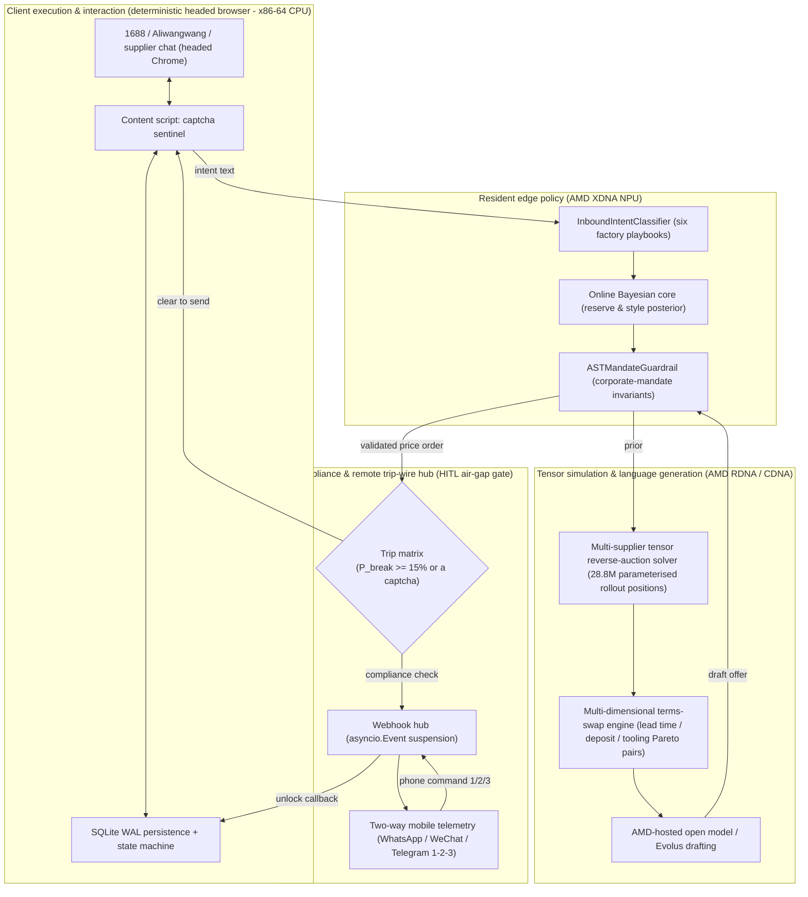

# TradeFlow AI — a one-person, AI-native cross-border trading company

> [!IMPORTANT]
> **Upfront prototype disclosure.** This is a **constrained procurement decision prototype** built for a hackathon. It has never been validated through a closed-loop deal with a real factory or a real supplier. Every benchmark and adversarial number below comes from a **self-built sandbox or from a parameterised simulation calibrated against academic literature**. The decision core is a **vectorised Expectimax solver**, and its validity depends strictly on the prior it is given. The AST guardrail only constrains numbers inside a structured policy object; the natural-language layer relies on templates and regex filtering. Full boundary audit: [LIMITATIONS_AND_REAL_WORLD_FINDINGS.md](LIMITATIONS_AND_REAL_WORLD_FINDINGS.md).

AMD Developer Hackathon: ACT III (lablab.ai, Online Build **2026/10/12–17**), two tracks:

- **Reinvent Commerce** (main business track)
- **Evolus Business Agents on AMD** (AMD business-agent track)

**In one sentence.** TradeFlow is not a tool sold to a procurement department — it is a **demonstration of how a one-person, AI-run cross-border trading company operates**. Facing information asymmetry and supplier gamesmanship, it splits the problem in two: a **vectorised Expectimax decision engine (pure numerics, no LLM in the decision loop)** and a **semantic negotiation layer (the LLM only phrases things)**. On the AMD compute topology it solves for a Pareto concession path and a dynamic BATNA. When the unit price deadlocks, a corporate mandate unlocks multi-dimensional non-price logrolling (deposit for lead time, full tooling waiver; the logrolling business rule caps deposit at 50%, with 60% as the last-line AST hard limit), while a human-in-the-loop compliance gate and an AST numeric guardrail hold the company's floor.

- Public repository: https://github.com/Fu93/tradeflow-ai
- Operations dashboard: http://localhost:8000 (Web Portal)
- Empirical adversarial and limitations report: [LIMITATIONS_AND_REAL_WORLD_FINDINGS.md](LIMITATIONS_AND_REAL_WORLD_FINDINGS.md)
- Real red-team stress-test transcript: [REAL_WORLD_STRESS_TEST_TRANSCRIPT.md](REAL_WORLD_STRESS_TEST_TRANSCRIPT.md)
- Self-play tournament baseline (grade-C synthetic simulation; **100 matches** = 20 per opponent archetype × 5, seed=42): [results/self_play_benchmark.md](results/self_play_benchmark.md)
- Submission checklist: [SUBMIT.md](SUBMIT.md) · Pitch: [PITCH.md](PITCH.md) · Archived planning docs (Chinese; internal record): [docs/archive/](docs/archive/README.md)

---

## User story: why open a one-person trading company?

> **There used to be two options, and both were bad.**
> * **Negotiate it yourself, overnight.** You grind through 1688 with Google Translate. The moment the factory hears a foreign buyer, the price jumps 20% (¥14.80 ex-works), and you cannot read the subtext when they say "tooling is billed separately" or quietly swap in second-grade material.
> * **Pay a 7% commission to an on-shore agent.** The agent takes a kickback from the factory, the deposit demand climbs to 80%, capacity slips, and both sides point at each other.
>
> **TradeFlow's answer is the third option: run the company yourself, with agents as staff.**
> One operator. Understanding supplier messages, price checking, risk control and tactic generation are all done by the system — **but the send button is always human** (the system never issues an offer on your behalf: AI proposes, the human decides).
> The **demo scenario** for a first order of 10,000 umbrellas: supplier opens at ¥14.80 → the engine's first counter is ¥13.02 (recorded in `results/real_stress_test_log.json` R1), which is about ¥1.78 per unit, roughly **¥17,800** (≈ $2,655) with zero kickbacks. The language layer is template output, double-checked numerically by AST and regex (boundaries in LIMITATIONS §5).
>
> *\*Provenance: the figure above is a **single-supplier worked example** (opening quote vs the engine's first counter), taken from the recorded bids in `results/real_stress_test_log.json`. It is not the final contract price of any specific factory, and it is not a site-wide statistic. Scenario label: ¥17,800 is the "single supplier, negotiation vs opening quote" scenario. The multi-supplier auction is a different scenario (`results/multi_supplier_auction.md`: settled at ¥12.60, which is 22.2% / ¥36,000 against our **walk-away ceiling** of ¥16.20, but only 5.0% / ¥6,600 against the first-round best quote of ¥13.26 — different baselines, so the API now returns all three and they must not be quoted interchangeably). The marginal gain over a "fixed concession each round" baseline is about +¥0.40 per unit (LIMITATIONS §13.5; the exact value moves with sampling). The three scenarios are not interchangeable.*

**This is exactly what the Evolus track asks for**: *"a real process that a real company runs every day."* There is no process more real than the company itself.

---

## Architecture (AMD heterogeneous compute, two decoupled agents)



---

## Technical highlights

1. **Tensor-parallel solving (28,800,000 parameterised rollout positions, not an execution count)**
   - The demo path `simulate_reverse_auction()` (the Web "Run Auction" button with default $n_{samples}=20{,}000$) evaluates $K \times S \times N_{open} \times N_{sched}$ combinations: 9.6M per round, **28.8M tensor positions** over three rounds.
   - **This is not a measured loop count.** The rollouts are produced by **one vectorised broadcast**; 28.8M is the number of parameter combinations evaluated at once (tensor elements), not iterations. Latency is the measured quantity (default 20K samples: `solve()` ≈ 1.7 s; a full HTTP round ≈ 2.6 s; 2K samples ≈ 0.30 s; measured on the development machine, an Intel Core Ultra 7 355 x86-64 CPU — see `results/bench.json` and LIMITATIONS §6.1).
   - Rollout positions = $K \times S \times N_{open} \times N_{sched}$; the benchmark harness uses 50,000 samples (72M); the theoretical upper bound of the largest strategy grid (40×12) is 96M, and **no execution path uses it**.
   - Evaluates $K=4$ suppliers, randomised opponent micro-parameters and many offer/concession-curve combinations at once.
   - Speedups on MI300X are an **analytical roofline projection of memory bandwidth**, not a hardware measurement (the development machine is an **Intel Core Ultra 7 355 x86-64 CPU**, not AMD hardware).

2. **Dynamic BATNA cross-pressure and three-tier tactics**
   - Computes the best outside option excluding supplier $i$ at each round: $\text{BATNA}_{-i}$.
   - Splits suppliers into `LEAN_IN` (lean in on the best price), `CROSS_ANCHOR` (cross-pressure the middle of the pack) and `SIDELINE` (freeze out the overpriced ones).

3. **AST hard-invariant guardrails between numbers and language (zero-hallucination)**
   - The LLM is not allowed to choose a price. Once the decision core emits the authorized target, the surface renderer's draft must pass strict regex and numeric boundary checks. Any unauthorized concession phrase or out-of-range price is cut immediately and degraded to a deterministic safe template.

4. **Counter-play against six supplier playbooks, and a bilingual bridge**
   - Detects "crying poor / raw-material spike", "volume blackmail / upsell", "spec downgrade / second-grade material", "tax and packaging unbundling", "offline private chat to escape monitoring" and "final concession".
   - A Western English-speaking executive types English parameters; the system negotiates as a seasoned China-based gold-tier buyer, removing the "foreign buyer premium".

5. **Two-stage semantic pipeline with a non-blocking design**
   - **Stage-1** (deterministic regex + on-device ONNX): **~1 ms**, 0 tokens, fully offline.
   - **Stage-2** (AMD-hosted open model): re-measured at **15–45 s** on 2026-10-17 (varies with endpoint load; the older "2–13 s" was optimistic), so it is off by default to avoid blocking HTTP requests. When deep semantics are needed, call `POST /api/v1/classify/semantic` out of band (client timeout defaults to 90 s, configurable via `VLLM_TIMEOUT_SECONDS`).
   - Covered by a regression test: `tests/test_async_stage2.py` asserts Stage-1 never makes a network call.

6. **Circuit breaker and a two-way mobile control loop**
   - Suspends instantly when breakdown risk $P_{\text{break}} \ge 15\%$ or the supplier pushes for an off-platform deal.
   - Pushes to WhatsApp / Telegram / WeChat; the manager replies `1` (concede), `2` (hold) or `3` (walk away) and the session unlocks remotely.

---

## Quick start

### 1. Install and launch the operations dashboard

```bash
git clone https://github.com/Fu93/tradeflow-ai.git
cd tradeflow-ai

# Pure Python; no Node.js / npm dependency
pip install -r requirements.txt

# FastAPI + dashboard + SSE live feed
python -m src.app.main
```

Open **`http://localhost:8000`**:

- **Live Bayesian chart** — SSE streams session state and posterior convergence every second.
- **Risk gauge** — breakdown probability, plus buttons that simulate a remote phone unlock.
- **Multi-supplier reverse-auction panel** — one click on `Run Auction` runs the tensor auction (28.8M parameterised positions, not an execution count).
- **Telemetry hot-reload panel** — configure WhatsApp / Telegram / WeChat tokens in the UI.

### 2. CLI

```bash
# [A] Four-supplier reverse-auction tensor demo (writes results/multi_supplier_auction.md)
python -m src.cli --multi

# [B] Adversarial self-play tournament (five opponent archetypes, writes results/self_play_benchmark.md)
python -m src.cli --self-play --matches 20

# [C] Robustness analysis (prior ±50% sensitivity vs a fixed-concession baseline)
python -m src.cli --robustness

# [D] Regenerate the figures used in the write-up (results/*.png)
python -m src.cli --figures

# [E] Single-supplier end-to-end Bayesian negotiation walkthrough
python -m src.cli
```

### 3. Chrome Manifest V3 copilot side panel

The repo ships a **copilot side panel** for 1688 / Alibaba pages (not an auto-send autopilot):

1. Open Chrome and go to `chrome://extensions/`.
2. Enable **Developer mode**.
3. Click **Load unpacked** and select the `extension/` directory.
4. Click the extension icon to open the side panel, or open `extension/mock_chat.html` for a risk-free sandbox conversation.

> **Copilot positioning.** The extension **passively listens** to the factory's messages and produces tactical cards the buyer **copies and sends manually**.
> The system never issues an offer itself, because in instant messaging a confirmed price *is* a binding offer — the power to contract stays with the human.
> (See [TARGET_ARCHITECTURE_AND_ROADMAP.md](TARGET_ARCHITECTURE_AND_ROADMAP.md) §1.1.)

---

## Tests and verification

The suite covers core logic, tensor math, intent classification, API routing, concurrent CAS writes, async semantics, safety guardrails and the end-to-end loop:

```bash
# Full suite
python -m pytest tests -q

# Real end-to-end business chain (circuit breaker, phone command, multi-supplier auction)
python verify_live.py

# Remove leftover test/verification sessions, keeping the three DEMO_* scenarios
# (dry run by default; pass --apply to delete)
python scripts/reset_demo_sessions.py
```

> **Your local data is not polluted by tests.** `pytest` redirects the session manager to a temporary directory via `tests/conftest.py`, and `verify_live.py` also defaults to a temporary store; `data/sessions.db` only changes when you use the dashboard yourself. Set `TRADEFLOW_DB_PATH` / `TRADEFLOW_STORE_DIR` if you want to keep a particular verification run.

> **Evaluation-validity disclosure.** To keep the claims honest, two very different evaluations are kept separate:
> - `tests/test_intent_benchmark.py` is an **in-distribution regression set**: its samples overlap heavily with the Stage-1 regex keywords (54 of 60 share the same stem). It detects behavioural regressions only and **cannot** be used to claim generalisation.
> - `tests/test_ood_500_benchmark.py` evaluates a **held-out split of a synthetic adversarial coverage set** (195 of 500 held out; the templates are disjoint from the ONNX training set). **Held-out accuracy is 63.08%**, P99 latency 0.27–1.14 ms across 12 runs.
> - **Correction on record.** The **92.00%** quoted in earlier drafts was a *training-set* score: the old `scripts/export_onnx_intent_model.py` trained the ONNX head on the whole OOD-500 set and then evaluated on the same data. The same model scores 92.79% on the training split and 63.08% held out — that gap is memorisation. Splitting, training and thresholds now all use the held-out set.
> - Both benchmarks assert against thresholds close to the measured values, so they can actually catch a regression instead of rubber-stamping one.

Verification output (`python verify_live.py`):

```text
[PASS] 1. Web Portal Dashboard GET / (Status: 200)
[PASS] 2. Static Assets (/static/css/theme.css, /static/js/app.js)
[PASS] 3. Session Created: test-session-live-01
[PASS] 4. Round 1 Cruising -> Intent: CRY_POVERTY_COST_HIKE
         Agent Tactical Reply: (Chinese script for the supplier — the buyer reads the decision card)
[PASS] 5. Round 2 Circuit Breaker Tripped -> Reason: Security escalation: OFFLINE_BYPASS_DIVERT
[PASS] 6. Mobile Webhook Command Executed -> Action: concede_step
[PASS] 7. Multi-Auction Run -> Winner: Supplier A (Agile Conceder)
         (Rollout positions: 28,800,000 = K×S×N_open×N_sched, parameterised grid count; not a measured execution count)
```

---

## Components and layout

| Directory / module | Responsibility |
|---|---|
| `src/web/` | Dashboard routes, SSE streaming, editorial layout and interaction scripts (design notes in [docs/DESIGN.md](docs/DESIGN.md)) |
| `src/engine/model.py` | Opponent micro-parameter sampling and the offer/concession grid |
| `src/engine/solver.py` | Single-opponent vectorised solve, Bayesian update and scalar selection |
| `src/engine/multi_solver.py` | **Multi-supplier tensor solver**, dynamic BATNA and three-tier tactics |
| `src/engine/bilingual.py` | **Cross-lingual cognition layer**, six-playbook intent classifier, numeric AST guardrail, two-stage pipeline |
| `src/engine/safe_regex.py` | Linear-time regex engine (bounded quantifiers, ReDoS-resistant) |
| `src/engine/onnx_classifier.py` | On-device ONNX intent classifier (pure local inference) |
| `src/benchmark/` | Adversarial self-play arena (`arena.py`) and five archetypes (`adversaries.py`) |
| `src/session/` | Session state machine (`schema.py`) and SQLite WAL atomic persistence (`manager.py`) |
| `src/transport/` | Pluggable transport, multi-channel telemetry (`telemetry.py`) and the two-way command hub (`webhook_hub.py`) |
| `src/evolus/` | Evolus REST client (AI Tools, workflow, agent chat) — **live-verified** |
| `extension/` | Chrome MV3 copilot side panel (passive listening, decision cards, one-click copy) |

---

## Judging alignment

| Criterion | How TradeFlow AI addresses it |
|---|---|
| **Originality** | Breaks with "the LLM is the decision maker": the math core decides, the LLM only phrases. The product form is **a one-person, AI-native trading company**, not another procurement SaaS. |
| **Business value** | Against the two traditional paths (negotiate overnight yourself / a 7% commission agent), it is **one operator**, **zero budget breaches** and **no intermediary, hence no kickback risk**. Quantified gain (grade-C synthetic simulation, 20 matches per archetype, 100 total; `results/self_play_benchmark.md`): savings **8.8%–20.0%**.<br>*That range is a simulation against parameterised opponents. Resolution is limited (20 matches per cell) and the engine is still slightly behind a "concede a fixed 5% each round" baseline against the Hard-Bargainer (8.8% vs 9.2%). We report it as measured instead of picking the favourable cells.* |
| **Application of technology (AMD)** | ① The engine is a tensor-broadcast workload; the `_xp()` abstraction moves from CPU to an AMD Instinct GPU (ROCm/CuPy) without touching the logic. ② The Stage-2 semantic layer is **live-connected** to an AMD-hosted open-model endpoint (HTTP 200 measured).<br>*The MI300X latency figure is an analytical roofline bound on data movement — not a hardware measurement and not a runtime prediction.*<br>*The development machine is an Intel Core Ultra 7 355 (x86-64); this project has **not** been executed on an AMD CPU.* |
| **Evolus integration** | Real API calls have produced usage stats: AI Tools `email` / `doc-structure` / `sentiment` (8.33 credits), with `src/app/orchestrator.py` completing the "Evolus callback → engine → Evolus drafting" chain.<br>*The workflow is not created yet; the agent (Supplier Negotiation Analyst) and the Personal Library knowledge base are created and verified (2026-10-14, LIMITATIONS §12). We do not claim the workflow is finished.* |
| **Presentation & rigor** | One-command Python start, a full automated suite with failure-injection (mutation) checks, "evaluation-validity" disclosures, a complete limitations report, production-grade SQLite WAL and a circuit breaker. |

---

## Known gaps

Listed so no reviewer is misled — these are **not done**:

- The Evolus **workflow** is not created (`GET /api/v1/workflows` returns an empty array). The **agent** (Supplier Negotiation Analyst) and the Personal Library knowledge base were created and verified on 2026-10-14 (LIMITATIONS §12); the workflow is follow-up work.
- **No MI300X hardware measurement**; the numbers are an analytical roofline projection.
- **No closed-loop deal with a real factory**; every metric comes from the sandbox and parameterised simulation.
- Stage-2 semantic latency measures **15–45 s** (re-tested 2026-10-17) and is unsuitable for millisecond interaction.

Full list in [SUBMIT.md](SUBMIT.md).
