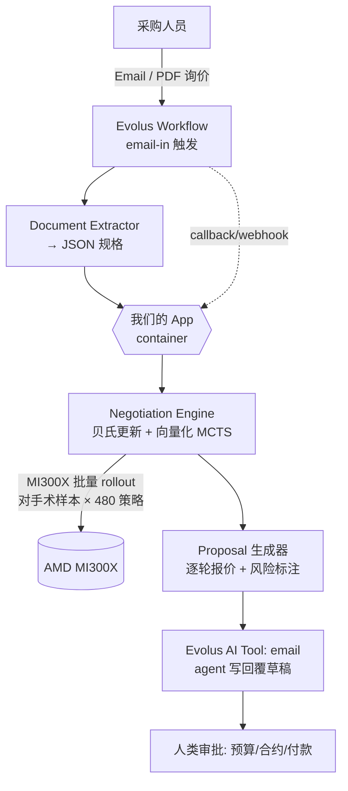

# 🏆 TradeFlow AI — 談判決策引擎

AMD Developer Hackathon: ACT III (lablab.ai, 2026/10/12–18) 參賽專案。

**一句話**：在不確定性下，用貝氏信念 + 在 AMD MI300X 上向量化蒙地卡羅搜尋，
算出採購談判的最優讓步策略；LLM 只負責寫信、讀信、解釋策略。

- 公開倉庫：https://github.com/Fu93/tradeflow-ai
- 策略文件：[TradeFlow_PlanB_Final.md](../TradeFlow_PlanB_Final.md)
- 執行手冊：[TradeFlow_Execution_Manual.md](../TradeFlow_Execution_Manual.md)
- 提交清單：[SUBMIT.md](SUBMIT.md)

## 架構



**关键不变量**：引擎是决策核心（可验证数学），Evolus 是语言层 + 工作流 + 文件解析。
GPU 跑的是引擎内部的批量 rollout，不是聊天 token。

## 快速開始（無 GPU、無外部依賴也能跑）

```bash
pip install -r requirements.txt
python -m src.cli                   # 端到端 demo（5 輪自動雨傘談判）
python -m src.cli --robustness      # 穩健性報告（regret vs 固定基準 + prior ±50% 敏感度）
python -m src.cli --figures         # 產 4 張圖 + bench.json 到 results/
python -m src.app.orchestrator      # 離線 orchestrator 自檢（模擬供應商回價）
```

`--figures` 會產出：
- `results/posterior.png`     — 末輪底價後驗分布 + 目標/上限/推薦開盤
- `results/belief_update.png` — 5 輪後驗均值±1σ 與推薦開盤同步演變
- `results/prior_decomp.png`  — 後驗分解成 4 類供應商成分（Wow#1 加強）
- `results/benchmark.png`     — CPU vs MI300X solve time（對數軸）
- `results/robustness.png`    — 引擎 vs 多種人為固定基準 + prior 敏感度
- `results/bench.json`        — 各 sample 數的耗時 / 投影

## 元件

| 路徑 | 職責 |
|---|---|
| `src/engine/model.py` | 4 對手類型 + 480 策略網格 |
| `src/engine/solver.py` | 向量化 MCTS + 貝氏更新 + 帕累托選擇 |
| `src/engine/proposal.py` | 讓步提案生成器（逐輪報價 + 風險標註） |
| `src/engine/robustness.py` | 多基準對比（3/5/10/15%） + prior 敏感度 |
| `src/engine/benchmark.py` | CPU 實測 + MI300X 投影 + JSON |
| `src/engine/viz.py` | 5 張視覺化（headless Agg） |
| `src/evolus/client.py` | Evolus REST client（workflow / AI Tools / agent chat） |
| `src/app/main.py` | FastAPI：`/negotiate`、`/webhook/evolus` |
| `src/app/orchestrator.py` | 膠水層：收 webhook → 跑引擎 → 叫 agent 寫信（離線 stub 兜底） |
| `src/app/demo_data.py` | 預錄供應商回價（穩定 demo） |
| `src/cli.py` | 一個指令三種模式 |
| `scripts/fetch_price_anchor.py` | best-effort 拉 HS6601 真實 FOB 區間 |
| `tests/` | engine / evolus / benchmark / api 四套 smoke test |

## 啟動 API

```bash
python -m src.app.main       # http://localhost:8000/docs
curl -X POST localhost:8000/negotiate -H 'Content-Type: application/json' \
  -d '{"product":"auto umbrella","target_price":12.0,"n_samples":20000}'
curl -X POST localhost:8000/webhook/evolus -H 'Content-Type: application/json' \
  -d '{"extracted":{"target_price":12.0},"offer":1.25,"email_body":"We can do ¥15, MOQ 500."}'
```

## 評估（四套 smoke test）

| 模式 | 命令 | 說明 |
|---|---|---|
| 邏輯 | `python tests/test_engine.py` | 模型/求解/貝氏/proposal/edge cases |
| API mock | `python tests/test_evolus.py` | Evolus client (mocked requests) |
| 性能 | `python tests/test_benchmark.py` | benchmark + 5 張圖能跑 |
| API | `python tests/test_api.py` | FastAPI `/negotiate` + `/webhook/evolus` (TestClient, offline) |

## 容器化（提交用）

```bash
docker compose up --build   # 一個指令跑起；.env 提供 key，絕不 commit
```

## 交付物一覽

| 檔案 | 說明 |
|---|---|
| `results/cover_1280x720.png` | 提交用封面圖 |
| `results/pitch.pptx` | 10 張投影片 |
| `results/demo_video.mp4` | Demo video（離線產出，~15s，3 Wows） |
| `results/posterior.png` | 末輪底價後驗分布 |
| `results/belief_update.png` | 5 輪均值±1σ 演變 |
| `results/prior_decomp.png` | 後驗分解成 4 類供應商成分 |
| `results/benchmark.png` | CPU vs MI300X |
| `results/robustness.png` | 多基準 + prior 敏感度 |
| `results/bench.json` | benchmark 數據 |
| `DEMO_SCRIPT.md` | 3-5 分鐘 demo video 旁白腳本 |
| `deploy.md` | AMD Developer Cloud 部署 runbook |
| `COMPETITION_STRATEGY.md` | 賽事評分研究 + 獲勝方程式 + gap 分析 |
| `SUBMIT.md` | 提交 checklist |

## 評分對照

- **Reinvent Commerce（主賽事）**：改善採購端 margin。
- **Evolus Business Agents on AMD**：event workspace + BYO vLLM + ≥2 building blocks + REST API 驅動。
- **AMD 技術**：引擎批量 rollout 在 MI300X 上跑（CPU 約 1s / 純 loop ~46s / MI300X ~0.4s）。

## 資料錨點（price anchor）

- `seed_data/price_anchor.json` 目前為**佔位**：UN Comtrade Plus / OEC 現已改為需登入 session，自動抓取（見 `scripts/fetch_price_anchor.py`）未取得即時 FOB 區間。
- 手動步驟已寫在該檔的 `market.manual_steps`；在 Demo 前填入 HS6601 真實 low/high 即可校準 prior。

## 注意

- 所有 key 走 `.env`（見 `.env.example`），`.gitignore` 已擋 `.env`。
- 引擎運算量 = 對手樣本 × 策略族（40×12=480 策略）；20k 樣本 = 960 萬 rollout。
- 商業價值錨點：專業採購議價常省 5–10%；100 萬美元訂單省 5% = 5 萬美元。
