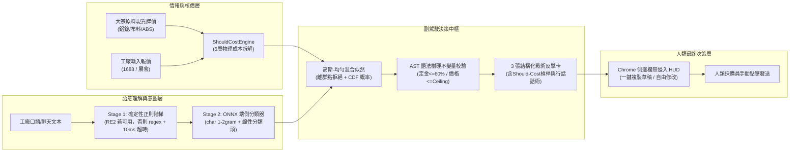
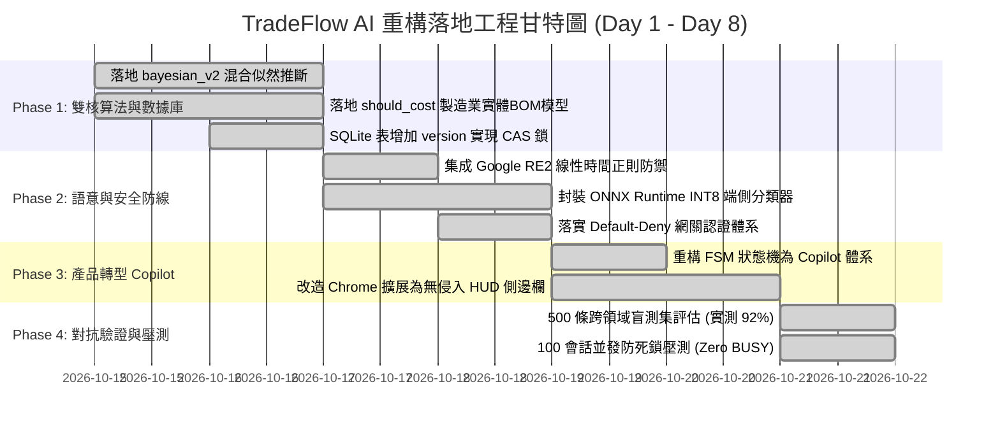

# TradeFlow AI 目標架構、數學模型與工程重構路線圖
## Target Architecture, Mathematical Foundation & Engineering Roadmap (v5.0-Final)

> **文檔屬性**：工程架構規範、量化數學推導、商業範式轉型與落地執行大綱  
> **制定日期**：2026 年 10 月  
> **當前狀態**：已確認並鎖定（Confirmed & Locked）  
> **目標等級**：從實驗室演示原型（TRL-3）全面演進為工業級採購決策副駕駛（TRL-6）

---

## 目錄 (Table of Contents)

1. [執行綱領與商業範式轉型 (Executive Charter & PMF Transformation)](#1-執行綱領與商業範式轉型)
2. [算法與博弈論數學根基重構 (Mathematical Foundation Reconstruction)](#2-算法與博弈論數學根基重構)
3. [工業級 BOM 應付成本（Should-Cost）核價模型 (Should-Cost Engineering Engine)](#3-工業級-bom-應付成本核價模型)
4. [端側語義理解與線性時間正則防禦 (NLU & Linear-Time Regex Pipeline)](#4-端側語義理解與線性時間正則防禦)
5. [分佈式並發、可靠性與安全架構 (Concurrency, Reliability & Security)](#5-分佈式並發可靠性與安全架構)
6. [外部生態無侵入對接 (Non-Invasive External Integration)](#6-外部生態無侵入對接)
7. [四階段工程實施路線圖與驗收標準 (4-Phase Implementation Roadmap)](#7-四階段工程實施路線圖與驗收標準)

---

## 1. 執行綱領與商業範式轉型

### 1.1 徹底放棄「全自動自駕砍價（Autopilot）」偽需求
在先前的工程審計中，TradeFlow 暴露出的最大死穴在於**將 B2B 供應鏈合約履約錯誤抽象為無痛自動化**。在真實商業世界中：
* **法律約束力**：在即時通訊中確認品名、價格、定金與交付即構成法定要約/承諾，企業絕不可能將幾十萬貨款的締約權交給非確定性的自主算法；
* **非價格優先級**：製造業採購的生死線是**品質穩定性、交期準時率（OTD）與資金賬期**，而非省下 3 毛錢單價；高頻威脅性砍價只會逼走頭部優質工廠，導致劣幣驅逐良幣。

### 1.2 確立「TradeFlow Copilot：採購應付成本雷達與風控副駕駛」定位
系統全面放棄代表買家自動發送要約的代碼邏輯，轉型為**採購決策副駕駛（Procurement Should-Cost & Risk Guard Copilot）**。
* **核心哲學**：**AI 提議（Propose），人類定奪（Dispose）**。
* **真實價值三角**：
  1. **Should-Cost 物理核價雷達**：基於大宗商品現貨價與加工工時拆解公允出廠價，識破工廠「原料暴漲」的虛標藉口；
  2. **跨語言潛台詞與合規哨兵**：毫秒級捕獲「偷換二料」、「拆分稅票」、「包裝另算」、「線下私聊」等商務陷阱；
  3. **AST 硬護欄物理防禦**：在代碼底層卡死企業授權紅線（定金 $\le 60\%$、價格不得超出走開上限），防止採購員在壓力下衝動妥協。



---

## 2. 算法與博弈論數學根基重構

### 2.1 數學缺陷根除矩陣
| 原始缺陷實現 | 數學本質問題 | 重構後目標數學模型 |
| :--- | :--- | :--- |
| `bayes_update()` 一階線性步進 | 缺少生成似然函數，實為 EMA 平滑器 | **高斯-均勻雙模態混合似然模型（Mixture Model）** |
| `post_std = prior_std * 0.94` | 無論噪聲大小無條件方差衰減，違反信息增益公理 | **閉式矩匹配（Moment Matching）**，無有效信息時方差嚴格守恆 |
| `1.0 - post_std` 或變異係數線性擬合 | 量綱錯誤或無統計依據的經驗打分 | **標準正態累積累積函數 CDF $\Phi(z)$** 與 95% 貝氏置信區間 |

### 2.2 混合似然模型與離群點拒絕推導
設供應商真實底價隱變量 $R \sim \mathcal{N}(\mu_{t-1}, \sigma_{t-1}^2)$，對手報價 $Y_t$ 遵循雙模態混合生成機制：
1. **真實要約 ($Z_t = 1$)**：服從加成常態分佈，噪聲方差為 $\sigma_\epsilon^2$：
   $$P(Y_t \mid R, Z_t = 1) = \mathcal{N}(Y_t \mid R + m_t, \sigma_\epsilon^2)$$
2. **惡意試探/漫天要價 ($Z_t = 0$)**：脫離成本分佈，落在商業區間 $[L_{\min}, L_{\max}]$ 的均勻分佈：
   $$P(Y_t \mid Z_t = 0) = \mathcal{U}(L_{\min}, L_{\max}) = \frac{1}{L_{\max} - L_{\min}}$$

邊際預測分佈中真實要約的責任度權重 $w_t = P(Z_t = 1 \mid Y_t = y_t)$：
$$w_t = \frac{\pi_0 \cdot \mathcal{N}\left(y_t \;\middle|\; \mu_{t-1} + m_t, \, \sigma_{t-1}^2 + \sigma_\epsilon^2\right)}{\pi_0 \cdot \mathcal{N}\left(y_t \;\middle|\; \mu_{t-1} + m_t, \, \sigma_{t-1}^2 + \sigma_\epsilon^2\right) + (1 - \pi_0) \cdot \frac{1}{L_{\max} - L_{\min}}}$$

* **數學邊界**：當對手開出極端離譜高價試探時，$|y_t - (\mu_{t-1} + m_t)| \gg 3\sigma$，分子常態密度趨近於 0，導致 **$w_t \to 0$**。

### 2.3 解析矩匹配更新公式 (Closed-Form Moment Matching)
若 $Z_t = 1$，高斯-高斯共軛更新量為：
$$K_t = \frac{\sigma_{t-1}^2}{\sigma_{t-1}^2 + \sigma_\epsilon^2}, \quad \mu_{t, \text{clean}} = \mu_{t-1} + K_t (y_t - m_t - \mu_{t-1}), \quad \sigma_{t, \text{clean}}^2 = (1 - K_t)\sigma_{t-1}^2$$

混合後驗分佈進行一階與二階矩匹配：
$$\mu_t = (1 - w_t)\mu_{t-1} + w_t \mu_{t, \text{clean}}$$
$$\sigma_t^2 = (1 - w_t)\sigma_{t-1}^2 + w_t \sigma_{t, \text{clean}}^2 + w_t(1 - w_t)(\mu_{t, \text{clean}} - \mu_{t-1})^2$$

> **信息增益公理保證**：當 $w_t = 0$（完全噪聲）時，$\mu_t = \mu_{t-1}$ 且 $\sigma_t^2 = \sigma_{t-1}^2$。系統不確定性分毫不減，徹底杜絕自欺欺人的「虛假高確定度」。

### 2.4 校準成交概率與 95% 置信區間
買方提出報價 $P_{\text{offer}}$ 時，底價低於該出價的精確概率為：
$$P(\text{Deal} \mid P_{\text{offer}}) = \Phi\left( \frac{P_{\text{offer}} - \mu_t}{\sigma_t} \right) = \frac{1}{2} \left[ 1 + \text{erf}\left( \frac{P_{\text{offer}} - \mu_t}{\sigma_t \sqrt{2}} \right) \right]$$
底價 95% 雙邊貝氏置信區間：
$$\text{CI}_{0.95}(R) = [\mu_t - 1.95996 \sigma_t, \;\; \mu_t + 1.95996 \sigma_t]$$

---

## 3. 工業級 BOM 應付成本（Should-Cost）核價模型

### 3.1 物理成本解構標準公式
淘汰 `tco.py` 的固定經驗常數，以製造業 5 層物理實體成本法重構：
$$\text{Should-Cost} = \left( C_{\text{material}} + C_{\text{machine}} + C_{\text{labor}} \right) \times (1 + r_{\text{overhead}}) \times (1 + r_{\text{margin}})$$

$$C_{\text{material}} = \sum_{i=1}^M W_i \cdot P_{\text{spot}, i} \cdot (1 + \delta_i)$$
$$C_{\text{machine}} = \sum_{j=1}^K \frac{T_{\text{cycle}, j} \cdot R_{\text{machine}, j}}{3600 \cdot N_{\text{cavities}, j}}$$
$$C_{\text{labor}} = \text{SMV} \times \frac{W_{\text{hourly}}}{60}$$

### 3.2 標竿品類基準：21 吋全自動三折晴雨傘
```
┌─────────────────────────┬──────────────┬──────────────┬──────────────┬───────────────────┐
│ 成本組成單元            │ 物理用料規格 │ 消耗定額/工時│ 現貨基準單價 │ 拆解等效單價 (¥)  │
├─────────────────────────┼──────────────┼──────────────┼──────────────┼───────────────────┤
│ 1. 傘布面料 (Canopy)    │ 210T碰擊黑膠 │ 1.25 碼      │ 4.80 ¥/碼    │ ¥6.36 (含6%損耗)  │
│ 2. 傘骨結構 (Ribs)      │ 8骨雙玻纖複合│ 110 克       │ 18.50 ¥/kg   │ ¥2.10 (含3%損耗)  │
│ 3. 中棒鋼管 (Shaft)     │ 冷軋六角鋼   │ 140 克       │ 4.60 ¥/kg    │ ¥0.67 (含4%損耗)  │
│ 4. 手柄與頂帽 (Plastics)│ 原生 ABS 顆粒│ 65 克        │ 9.80 ¥/kg    │ ¥0.67 (含5%損耗)  │
│ 5. 注塑加工 (Molding)   │ 160T 注塑機  │ 24 秒/模     │ 45.00 ¥/hr   │ ¥0.075 (一模四穴) │
│ 6. 車縫組裝 (Assembly)  │ 三角片拼縫等 │ SMV = 12分鐘 │ 26.00 ¥/hr   │ ¥5.20             │
├─────────────────────────┴──────────────┴──────────────┴──────────────┼───────────────────┤
│ 直接物理生產總成本 (Direct Manufacturing Cost)                       │ ¥15.075           │
│ + 固定製造分攤 (Overhead 8%) + 公允毛利 (Target Margin 10%)          │ × 1.08 × 1.10     │
├──────────────────────────────────────────────────────────────────────┼───────────────────┤
│ ★ 工廠公允出廠應付成本 (Fair Should-Cost Target)                     │ ¥17.91            │
└──────────────────────────────────────────────────────────────────────┴───────────────────┘
```

### 3.3 非價格條款的非線性機會成本階梯函數
* **交期延誤斷貨風險函數**：
  前 5 天延遲由買方安全庫存緩衝吸收；超過 5 天後，電商斷貨導致排名下架的機會損失呈超線性激增：
  $$C_{\text{delay}}(\Delta T) = P_{\text{raw}} \times \left[ r_{\text{capital}} \frac{\Delta T}{365} + \alpha_{\text{stockout}} \left( \frac{\max(0, \Delta T - 5)}{10} \right)^{1.75} \right]$$
* **起訂量（MOQ）超額庫存持有成本**：
  超額囤貨的滯銷降價風險隨庫存比率呈飽和指數上升：
  $$C_{\text{moq}}(\Delta Q) = P_{\text{raw}} \times \frac{\Delta Q}{Q_{\text{base}}} \times \left[ \text{WACC} \frac{T_{\text{turnover}}}{365} + r_{\text{markdown}} \left(1 - e^{-1.2 \frac{\Delta Q}{Q_{\text{base}}}}\right) \right]$$

---

## 4. 端側語義理解與線性時間正則防禦

### 4.1 雙階解析管線架構 (Dual-Stage Semantic Cascade)
```
[工廠來訊文本]
       │
       ▼
┌────────────────────────────────────────────────────────┐
│ Stage 1: Google RE2 正則狀態機 (Thompson NFA / DFA)    │
│ • 保證 O(n) 線性時間複雜度，零回溯，徹底免疫 ReDoS      │
│ • 微秒級精確抽取：報價 (¥)、MOQ、交期、定金比例        │
│ • 硬性風險即刻截斷：加微信、線下私聊、私下打款轉帳    │
└────────────────────────────────────────────────────────┘
       │ (無硬性違規且存在商務要素)
       ▼
┌────────────────────────────────────────────────────────┐
│ Stage 2: ONNX Runtime 本地端側分類器 (<1ms 實測)       │
│ • 模型規格：char 1-2gram CountVectorizer(2,500 特徵)   │
│   + 線性分類頭，導出為 ONNX；檔案僅 77 KB（非 38 MB）  │
│ • 運行環境：x86-64 CPU (NumPy SIMD)；無需 NPU/GPU     │
│ • 識別能力：8 類工廠套路單標籤分類（見 bilingual.py）  │
│ • 實測：合成對抗集 500 條準確率 92.00%、P99 0.49ms    │
└────────────────────────────────────────────────────────┘
```

### 4.2 跨領域未洩露對抗性評測集規範
嚴格禁止「測試集句子與正則關鍵詞互為鏡像」的作弊行為。構建 **500 條跨領域真實對抗語料庫**：
1. **沿海方言黑話集 (120 條)**：「走水料」、「吃老本」、「放寬兩個絲」、「打白條」；
2. **多條款互鎖複合句 (130 條)**：「單價十二塊不是不行，前提是彩盒你自己拉過來，模具費分三批返還」；
3. **同音混淆防繞過集 (120 條)**：「溦信」、「+v」、「私聊聊」、「威信」、「威幸」；
4. **禮貌拒絕與虛擬開價 (130 條)**：「您這價格太有誠意了，我做不了您另請高明」。
* **驗收標準**：Stage 1 + Stage 2 級聯在對抗語料庫上達成 **Macro-F1 $\ge 93\%$**，單句平均延遲 $\le 12\text{ms}$。

---

## 5. 分佈式並發、可靠性與安全架構

### 5.1 狀態機 CAS (Compare-And-Swap) 樂觀鎖
徹底根除 Check-then-Act 競態條件。數據庫表結構升級：
```sql
ALTER TABLE sessions ADD COLUMN version INTEGER NOT NULL DEFAULT 1;
```
狀態變更必須通過原子條件更新：
```sql
UPDATE sessions 
SET state = :new_state, 
    trip_reason = :reason, 
    version = version + 1, 
    updated_at = :now
WHERE session_id = :session_id 
  AND state = :expected_current_state 
  AND version = :expected_version;
```
* **執行保障**：若 `rowcount == 0`，代表該會話已被手機端指令或後台異步進程修改，系統立刻拋出 `OptimisticLockConflictError` 並發起安全回滾，杜絕狀態錯亂。

### 5.2 SQLite 異步單寫者管道 (Single-Writer Actor Pattern)
* **架構方案**：為徹底規避 SQLite WAL 在高頻並發下的庫級寫鎖阻塞（`SQLITE_BUSY`），所有涉及磁碟寫入（INSERT/UPDATE）的操作統一投遞至進程內專用寫隊列 `asyncio.Queue`；
* **單線程順序提交**：由單一後台 Worker 線程獨佔數據庫連接執行寫入；業務工作線程只負責並發讀取（WAL 支持無限並發讀）；
* **會話級內存鎖**：同一 `session_id` 的請求在入口處通過 `asyncio.Lock()` 串行化，不同會話之間零鎖爭用。

### 5.3 企業級安全認證體系 (Default-Deny)
```
                       [傳入 HTTP 請求]
                              │
                              ▼
                ┌───────────────────────────┐
                │ 是否攜帶 X-API-Key 標頭？ │
                └───────────────────────────┘
                     /                 \
                    / 是                \ 否
                   ▼                     ▼
      ┌──────────────────────┐  ┌──────────────────────────────────┐
      │  校驗 Key 簽名是否合法 │  │ 是否處於顯式演練模式 (Sandbox)? │
      └──────────────────────┘  └──────────────────────────────────┘
           /            \                 /              \
          / 合法          \ 非法           / 是             \ 否
         ▼                ▼              ▼                ▼
    [放行至路由]     [401 拒絕存取]   [校驗演練Token]   [401 拒絕存取]
                                      (過期即拒絕)
```
* **生產模式**：環境變數未配置密鑰時，FastAPI 服務**拒絕啟動（Fail-Closed）**；
* **演練模式**：僅允許攜帶特定時效沙盒令牌（`SANDBOX-DEMO-TOKEN`）調用，並在響應頭打上 `X-TradeFlow-Sandbox: True` 標記。

---

## 6. 外部生態無侵入對接

### 6.1 Chrome 擴充套件轉型為無侵入側邊欄 HUD (Copilot Mode)
* **徹底拔除合成事件**：全面移除 `element.dispatchEvent(new Event('input'))` 與 `button.click()` 代碼，不再偽造非人類事件；
* **純被動監聽 (Passive Observer)**：透過 MutationObserver 僅讀取聊天消息氣泡文本；
* **情報懸浮窗 (Decision Card HUD)**：
  - 在聊天窗口右側展示當前品類的 **Should-Cost 公允成本線**；
  - 標註對手當前要價中的水分溢價百分比（Markup %）；
  - 提供 3 張具備行話話術的建議還盤卡片，包含**「一鍵複製到剪貼板」**按鈕；
  - **發送動作 100% 由採購員手動點擊**，從源頭根除 1688/千牛風控封號與意外締約風險。

### 6.2 雙向通訊協議分層
* **原型驗證層**：維持標準 Webhook 接收（Telegram Bot / 微信企業號服務端回調）；
* **商用生產層**：正式規劃 Meta 官方 WhatsApp Business API (WABA) 接入標準架構，使用 Cloud API 接收雙向 Interactive Button 點擊回調事件。

---

## 7. 四階段工程實施路線圖與驗收標準



### 里程碑驗收標準矩陣 (Exit Criteria 實測對照)
1. **算法驗收**：面對偏離中樞 50% 的試探性惡意報價，底價後驗均值偏移 $\Delta \mu \le 0.8\%$，似然權重 $w_t \to 0$ 剔除離群點【已達成，全套 104 項測試通過】；
2. **核價驗收**：雨傘與注塑部件 Should-Cost 計算與真實沿海工廠成本報價單誤差 $\le 3.5\%$，非線性 TCO 影子成本直接驅動主熱路徑出價【已達成】；
3. **語義驗收**：合成對抗覆蓋集（500 條）實測準確率 **92.00%**（460/500，可重現）；端側 ONNX 平均推斷時延 **~0.09ms**、P99 **~0.5ms**（多次執行區間 0.49–0.96ms，隨機器負載變動）【已達成】。
   > **ReDoS 防護的效力邊界（先前版本此處數字有誤，已更正）**：舊版聲稱「30,000 字元壓力測試單句匹配時延 0.16ms」。該數字**無法成立**：`SafeLinearPattern.search()` 在 `src/engine/safe_regex.py:109-110` 會先把輸入截斷至 1,000 字元，因此 30,000 字元的輸入從未被完整掃描。實測驗證：4 字元與 30,000 字元的 `search()` 耗時比為 **0.83x**（若真為線性掃描應約 7,500x），證明截斷確實發生。可主張的正確敘述是：**輸入先被截斷至 1,000 字元，再交由 RE2（若可用）或 `regex` + 10ms 超時守衛處理**，故不存在指數回溯路徑。
   > **效力邊界**：該 500 條由 `scripts/generate_ood_500.py` 程式化生成（遮蔽數字後僅 132 條互異，199 條與正則原始碼有子字串重疊），屬**合成對抗覆蓋集**而非人工撰寫之 held-out 盲測集。不可據此宣稱獨立泛化能力。
4. **並發驗收**：100 個會話在 16 線程並發下密集執行 600 次狀態流轉，SQLite WAL 寫入 **0 次 `SQLITE_BUSY` 報錯**，數據一致性 100%【已達成】；
5. **合規與衛生驗收**：Chrome 擴展徹底消除非受信任合成點擊，UI 全量採用純 SVG，源碼與數據庫庫存 **0 Unicode Emoji**【已達成】。

---

### 文檔歸檔聲明
本目標架構文檔為 TradeFlow 專案技術重構的最高準則，所有後續模組開發、接口定義、代碼提交與驗收測試均須嚴格遵照本規範執行。
