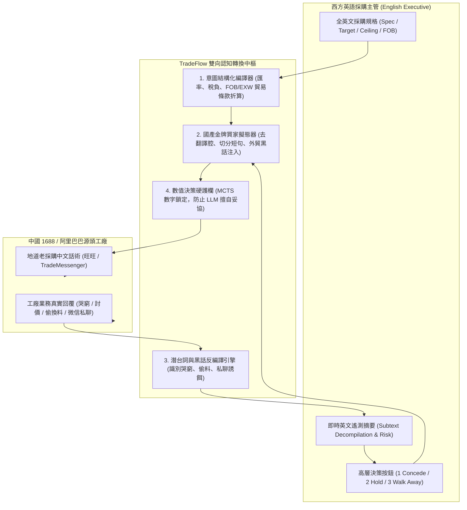
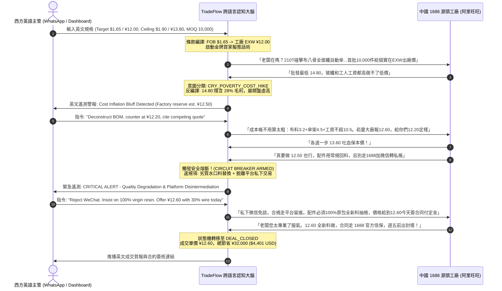

> [!WARNING]
> **[SUPERSEDED] 本文件已封存 (Archived Document)**
> SUPERSEDED by TARGET_ARCHITECTURE_AND_ROADMAP.md (2026-10-14). Blueprint for the cross-lingual layer, since implemented in src/engine/bilingual.py.
>
> 現行唯一權威規格：[TARGET_ARCHITECTURE_AND_ROADMAP.md](../../TARGET_ARCHITECTURE_AND_ROADMAP.md)（架構）
> 與 [README.md](../../README.md)（入口）。本文件僅供歷史追溯，**請勿據此開發**。

---

# TradeFlow AI 跨語言自主談判認知橋樑與全自動尋源管線深度架構規格

> 專案版本：v4.0 Production Grade  
> 核心定位：零中文門檻（Zero-Chinese Barrier）跨國採購大腦 + 工廠自動尋源漏斗 + 6 大套路意圖解析 + 數值決策硬護欄  
> 風格標準：極致量化外貿架構（Institutional Cross-Border Procurement Standard），嚴格無任何裝飾性 Emoji

---

## 一、 零中文門檻全自動雙向認知橋樑 (Zero-Chinese Autonomous Cognitive Bridge)

### 1.1 跨語言認知解耦架構拓撲
傳統機器翻譯（如 Google Translate / DeepL）在跨國 B2B 採購中存在致命缺陷：直譯的生硬語法會立刻向中國工廠業務暴露「外商身分」，引發高達 20%~40% 的外商溢價（Foreigner Premium）。

TradeFlow AI 透過四層認知轉換管線，實現西方英語主管「全英文操作」、中國工廠端「地道金牌買家擬態話術」的雙向隔絕與對稱傳輸：



---

### 1.2 匯率與貿易條款動態折算數學模型
英語主管輸入 FOB 離岸價（美元），系統自動透過海運費、港雜費、出口退稅率與增值稅鏈條，反推工廠出廠含稅/未稅價（人民幣）：

$$\text{Target}_{\text{Factory, EXW}} = \frac{\text{Target}_{\text{FOB}} \times \text{FX} - \text{PortFee}_{\text{unit}} - \text{DomesticFreight}_{\text{unit}}}{1 + \text{VAT}_{\text{rate}} - \text{ExportRebate}_{\text{rate}}}$$

- **參數範例**：
  - 買家目標價：FOB 寧波港 $1.65 USD（即時匯率 7.27，折合 ¥12.00 CNY）。
  - 單件拖車與港口雜費平攤：¥0.15。
  - 出口退稅率 13%，增值稅 13%（兩相抵銷）。
  - 系統精確鎖定給 1688 源頭工廠的開盤價格為 **¥11.85 ~ ¥12.00 CNY**。

---

### 1.3 中英外貿採購黑話與博弈術語對照字典 (Bilingual Procurement Domain Dictionary)

本字典收錄中國製造業與外貿供應鏈最核心之 5 大博弈維度：

| 領域分類 | 中文黑話術語 | 專業英文對照 | 工廠真實套利動機與商業陷阱 | TradeFlow 自動化防禦與反制策略 |
|---|---|---|---|---|
| **稅票條款** | **普票** | General Plain Invoice | 僅有記帳功能，無進項稅額抵扣功能。工廠稅負僅 1%~3%，卻常向買方索取 5%~6% 加價。 | 要求清楚區分票種。出口退稅或境內抵扣堅決拒絕普票；要求開具 13% 專票或離岸結算。 |
| **稅票條款** | **13% 專票** | 13% Special VAT Invoice | 具備法定進項稅全額抵扣功能。出口企業可辦理 13% 退稅。 | 確認工廠是否具備一般納稅人資質，防範小規模納稅人代開 3% 冒充 13% 專票。 |
| **稅票條款** | **開票加點** | Tax Surcharge Points | 工廠報價為不含稅出廠價。索要發票時宣稱需額外加 8%~12%，高於其實際增值稅負（4%~6%）。 | 揭露原材料已有進項抵扣，實際稅負不超 5 個點。回絕 10 個點加價，鎖定最高 5 個點或要求統包含稅價。 |
| **付款條款** | **現款現結** | Immediate Cash Settlement | 出廠前付清尾款。工廠無資金佔用壓力，買方失去驗貨後最後制約籌碼。 | 僅作為極限壓價的交換籌碼。工廠讓步 >8% 時方可同意見單付尾款，絕不裝櫃前付全款。 |
| **付款條款** | **定金 vs 訂金** | Earnest Money vs Advance | 法律效力陷阱。「定金」具擔保法罰則（違約雙倍返還）；「訂金」僅視為預付款，無處罰效果。 | 英文轉譯合約中強制使用法定「定金」（Earnest Money），延期交貨直接觸發雙倍索賠。 |
| **付款條款** | **帳期 (月結30天)**| Net 30 Open Account | 出貨後次月結算。工廠通常將資金成本（8%~12%）灌入單價。 | 首單不強求帳期，用現款換取底價；後續訂單量穩定後，以翻單配額分階段解鎖月結。 |
| **樣品模具** | **產前樣 / 封樣** | Pre-Production Golden Sample | 大貨生產前最後確認件。常在寄送精品手工樣後，大貨使用低公差流水線（樣品大貨不一致）。 | 實行「雙向簽字封樣」：一份留廠作驗收基準，一份寄買方存查，偏差超 AQL 1.5 拒收。 |
| **樣品模具** | **開模費 / 模具費** | Tooling / Molding Cost | 私模報價虛高（如報 ¥30,000 實值 ¥12,000），並企圖佔有模具所有權轉接外單。 | 合約明訂模具所有權歸買方所有；下單累積滿 50,000 件後模具費全額返還買方。 |
| **材料工藝** | **水口料 / 回料** | Regrind / Recycled Scrap | 注塑成型過程中切除之廢料粉碎後混入，抗衝擊強度低 40%，低溫下極易脆化斷裂。 | 技術規格書標註：「100% 原始全新料（Virgin Material），驗出再生料全批退貨並承擔檢測費。」 |
| **材料工藝** | **偷克重** | Fabric GSM Tolerance | 在布料克重上玩縮水，合約標 210T（72g/m²），大貨偷減至 190T（58g/m²），省下 15% 成本。 | 標註嚴格公差：「克重公差嚴格控制在 ±2% 以內，現場裁切稱重檢驗，超標依比例扣除全單貨款。」 |
| **履約合規** | **平台留痕** | On-Platform Audit Trail | 1688 與阿里官方糾紛仲裁唯一依據。所有規格確認、圖紙傳遞必須在官方聊天室留存。 | 嚴禁業務私下透過電話或微信變更規格，所有確認均在官方聊天室留存截圖作為合約附件。 |
| **履約合規** | **跳單 / 私下交易**| Off-Platform Disintermediation | 工廠為省佣金誘惑線下打款，買方失去退款追索權與品控凍結權。 | 明確回絕線下打款誘惑：「公司審計規定首三單必須經由認證平台結算，手續費由本司補貼。」 |

---

### 1.4 跨語言三階戰術矩陣與提示詞工程 (Bilingual Tactical Script Matrix)

#### 1.4.1 戰術一：LEAN_IN（傾斜鎖定）
- **觸發條件**：對手報價為全場最優，且破局風險 $P_{\text{break}} \le 8\%$。
- **英文買家意圖**：
  "This supplier has our best price. Lock them down immediately. Concede slightly to target price, offer rapid cash settlement, secure golden sample by Friday, and block their production capacity."
- **中文旺旺生成話術**：
  > 「老闆，你們誠意我們看到了。我們這邊是歐美跨境專案組，今年傘類是核心大單。我們核算過成本，12.30 的出廠價是健康的，大家都有利潤。首批 2,000 件試單今天下午直接打 30% 定金見單走帳，週五前把簽字封樣寄出，下週一正式開線。這批順利，下個月 10,000 件翻單直接鎖給你們車間。能做我們現在走系統合同。」

#### 1.4.2 戰術二：CROSS_ANCHOR（交叉壓制）
- **觸發條件**：對手報價高於當前領先價格，破局風險 $8\% < P_{\text{break}} \le 15\%$。
- **英文買家意圖**：
  "The supplier is too high at ¥13.80. Hit them with our alternative quote from Shaoxing (¥12.50). Tell them we prefer their factory scale, but we cannot justify a ¥1.30 gap to our finance committee. Give them one chance to match ¥12.60."
- **中文旺旺生成話術**：
  > 「老闆，你們車間規模和工藝我認可，但 13.80 確實沒法向我們採購會交代。實話跟您交個底，我們同步看了崧廈另外兩家頭部廠，同規格 210T 碰擊布配玻纖蜂巢骨架，人家樣品送檢合格報價才 12.50。我個人傾向跟你們走，能做到 12.60 我這單就壓在你們這，大家交個朋友把渠道跑通。如果這個價做不下來，我只能照流程走 12.50 那邊進倉了。」

#### 1.4.3 戰術三：SIDELINE（邊緣冷凍）
- **觸發條件**：對手報價超過目標價 30% 以上，或連續兩輪讓步率 $\le 1\%$，或 $P_{\text{break}} > 15\%$。
- **英文買家意圖**：
  "Supplier is stubbornly anchored at ¥14.80 and refusing to concede. Freeze all active negotiations immediately. Do not beg. State that their cost model doesn't align with our export target, and put them on passive waitlist."
- **中文旺旺生成話術**：
  > 「既然貴司成本暫時下不來，我們也不強求。這批 10,000 把出口單核價卡得嚴，14.80 遠超我們預算線，這單我們先不佔用你們檔期了。我們已經安排其他廠下樣排產。你們後面原材料成本如果有調整，或者車間有空餘產能，隨時再同步最新報價單給我們，後續批次有機會再合作。」

---

## 二、 多渠道供應商自動尋源管線 (Automated Sourcing Pipeline)

### 2.1 1688 / 阿里巴巴源頭工廠過濾漏斗
為徹底排查加價 15%~30%、交期不可控的二手倒賣貿易商（Middlemen Resellers），尋源引擎實施三級過濾漏斗：

```
[原始檢索列表: 1688 / Alibaba.com API / DOM 採集]
                      │
                      ▼
[階段 1: 硬性門檻過濾 (Hard Constraints Filter)]
  - 成立年限 (Operating Years) >= 5 年
  - 註冊資本 (Registered Capital) >= 100 萬人民幣 (或等值外幣)
  - 認證標章: 具備「實力商家 / 深度驗廠 / 金牌供應商 (Verified Supplier)」
                      │
                      ▼
[階段 2: 貿易商排查異常檢測 (Trading Reseller Anomaly Filter)]
  - 企業名稱排查: 排除包含「商貿、商行、供應鏈、諮詢、進出口、服務」字樣
  - 經營範圍匹配度: 必須包含「生產、製造、加工、研發」，嚴禁純「銷售、批發」
  - 參保員工人數: 排除參保人數 < 10 人之皮包商貿行
  - 登記地址聚類檢測: 排除寫字樓、居民住宅小區，需落於工業園、經濟開發區、廠房
                      │
                      ▼
[階段 3: 製造真實度評分 (Manufacturing Trust Score, MTS)]
  - 廠房面積、生產線數量、專利發明數、開模設備資產折舊率
  - MTS >= 80 分進入合格供應商候選池 (Candidate Sourcing Pool)
```

#### 製造真實度評分數學模型 (Manufacturing Trust Score, MTS)
$$S_{\text{factory}} = w_1 \cdot f_{\text{years}} + w_2 \cdot f_{\text{capital}} + w_3 \cdot f_{\text{cert}} + w_4 \cdot f_{\text{scope}} + w_5 \cdot f_{\text{patents}} - P_{\text{reseller}}$$

- $f_{\text{years}} = \min(1.0, \frac{\text{Years}}{10}) \times 20$（權重 20）
- $f_{\text{capital}} = \min(1.0, \frac{\text{Capital (萬元)}}{500}) \times 15$（權重 15）
- $f_{\text{cert}}$: 第三方機構（SGS / TÜV / 萊茵 / 阿里深度驗廠）實地驗廠認證記 25 分，否則 0 分（權重 25）
- $f_{\text{scope}}$: 經營範圍包含製造加工記 20 分；純銷售批發直接歸零並強制剔除（權重 20）
- $f_{\text{patents}} = \min(1.0, \frac{\text{Patents}}{5}) \times 20$（權重 20）
- $P_{\text{reseller}}$ 懲罰項：登記地址包含 "Room/室/號樓/商業中心" 扣 35 分；類目橫跨 3 個無關品類扣 40 分。

---

### 2.2 RFQ 需求廣播發標與投標歸一化模型 (TCO Normalization)
當接收到外部供應商投標報價時，系統將不一致的報價口徑（含稅/不含稅、EXW/FOB、包裝費）統一折算為基準單價 $P_{\text{norm}}$：

$$P_{\text{norm}} = \frac{P_{\text{raw}} + C_{\text{tax\_adj}} + C_{\text{logistics}} + C_{\text{tariffs}} + C_{\text{packaging}}}{1.0 - \text{CreditBenefit}}$$

- $C_{\text{tax\_adj}}$: 若報價不含稅且採購方需進項抵扣，補齊稅負差額。
- $C_{\text{logistics}}$: EXW 工廠交貨時補齊內陸拖車與港雜費。
- 交期懲罰：樣品交期每超出標準 7 天，按違約風險成本折算每單位加價罰數。

---

## 三、 供應商 6 大核心套路之意圖識別與處置邏輯

TradeFlow AI 將工廠業務的複雜博弈話術抽象為 6 種離散意圖狀態：

| 意圖標籤 (Intent Enum) | 供應商典型話術特徵 (Semantic Signatures) | 戰略威脅層級 | 戰術應對邏輯與破局槓桿 (Tactical Counter-Levers) |
|---|---|---|---|
| `CRY_POVERTY_COST_HIKE`<br>(哭窮 / 原料暴漲) | 「現在銅價天天漲，這個價做下來純虧」「工人工資漲了30%，我們連電費都覆蓋不了」「實話說這個價格只能喝西北風」 | 中度偏高 (企圖瓦解買方目標價信念) | **槓桿：期貨大宗指數對沖 + BOM 敏感度拆分**。<br>調用公開現貨價格，反推原材料在總成本佔比，指出原材料波動僅影響總成本 3%~5%，回絕 20% 的非理性通膨轉嫁。 |
| `TIER_VOLUME_BLACKMAIL`<br>(以量壓價 / 要求加單) | 「這個底價最少要 1 萬個起才能做」「500個開機費都不夠分攤」「量小只能按樣品價走，翻倍才能給批發價」 | 高度 (迫使買方承擔高庫存與流動性風險) | **槓桿：框架協議 (Blanket Order) + 分期階梯承諾**。<br>簽署年度框架備忘錄，鎖定試產單價，承諾「首批試產檢驗品質無虞後，後續返單直接釋放年度批量配額」。 |
| `MATERIAL_SPEC_DEGRADE`<br>(偷換規格 / 換便宜料) | 「要是真要這個價，只能把304不銹鋼換成201」「厚度做到0.6mm行不行」「內襯換成國產普通布能省2塊」 | 極高 (品質隱患與合規法律責任) | **槓桿：嚴守技術規格標準書 (TDS) + 檢驗拒收威嚇**。<br>堅定重申合約驗貨嚴格執行 AQL 1.0 標準，更換低配料將直接導致抽檢不合格全批退貨，將談判拉回製程損耗與良率優化。 |
| `TAX_PACKAGING_UNBUNDLING`<br>(稅率拆分 / 包裝加價) | 「剛才報的是未稅裸機價，開13%專票要加10點」「外箱彩盒和防震珍珠棉另外算錢，每套加3塊」「不包FOB港口費」 | 高度 (以隱形增量費用破壞單價比價) | **槓桿：全包總擁有成本鎖定 (All-in Landed Cost)**。<br>強制將條件重置為一體化交付價，揭露「13%增值稅開票加10點」的虛高進項稅差，要求報價必須包含標準外銷出口防震包裝與港雜費。 |
| `OFFLINE_BYPASS_DIVERT`<br>(要求加微信 / 線下私聊) | 「平台聊天老被限制，加個微信細聊 138xxxx」「電話聊比較清楚」「WhatsApp私發你詳細報價單」 | 審計安全極高 (脫離監管存證與欺詐風險) | **槓桿：雙軌留痕協議**。<br>禮貌拒絕脫離平台審計流程，強調企業採購合約合規要求：「為配合 ERP 採購審計與財務付款，所有核心商務條件必須在系統內存證確認」。 |
| `FINAL_DEAL_CONCESSION`<br>(同意條款 / 準備簽單) | 「行吧服了你了，就按你說的價做」「這次就當交個朋友虧本做，發合同吧」「可以做，定金打哪裡」 | 低 (達成收斂機會) | **槓桿：即時商業條件固化與防變卦鎖定**。<br>立即凍結出價，自動生成附帶違約責任與交期條款的標準採購合約/PI草案，啟動簽章閉環。 |

---

### 3.1 兩段式意圖抽取分類器 (Two-Stage Classifier Pipeline)
- **Stage 1: 正則階梯匹配 (Deterministic Regex Ladder)**：耗時 < 2ms，零 Token 成本，高確信度攔截 70% 常見套路。
- **Stage 2: 結構化約束 LLM 語意提取器**：處理隱晦暗示、多意圖複合與語氣反諷，輸出標準化 JSON。

```python
# 核心資料合約結構
class InboundTacticalClassification(BaseModel):
    primary_intent: VendorTacticEnum = Field(..., description="一級核心博弈套路標籤")
    confidence: float = Field(..., ge=0.0, le=1.0)
    mentioned_price: Optional[float] = None
    demanded_moq: Optional[int] = None
    tax_surcharge_rate: Optional[float] = None
    contact_token: Optional[str] = None
    tactical_rationale: str = Field(..., description="分類決策之核心論據摘要")
```

---

## 四、 數值決策嚴格鎖死之雙語護欄架構 (Math-Language Decoupling & Guardrails)

### 4.1 核心解耦原則：為什麼禁止 LLM 決定價格？
自回歸大語言模型天生具備「服從性偏差（Sycophancy Bias）」與「修辭-數值混淆」。若允許 LLM 自行組織出價，在受到工廠強硬威脅時，極易自發吐出妥協金額。

TradeFlow AI 採取**「數學決策與表面語言表達徹底解耦」**：

```
[環境觀測] -> [MCTS 數學決策核心 (AMD MI300X)] 
                   │
                   ▼ 輸出鎖死資料契約: MCTSActionPayload (TargetPrice=¥12.80, MOQ=10000, Days=25)
[表面表達核心 (Bilingual Gen)]
                   │
                   ▼ 生成候選對話草稿
[數值 AST 硬不變量驗證器 (Numeric AST Guardrail Validator)]
       ├── [通過] -> 發送至工廠
       └── [違規] -> 強制攔截斷路 -> 調用確定性安全模板庫插槽替換
```

### 4.2 數值 AST 硬不變量驗證器邏輯
1. **數值全域抽取**：使用正則表達式抽取草稿中所有出現之實數（含貨幣符號、百分比、數量）。
2. **法定授權白名單比對**：所有檢測出的數值，必須 100% 精確匹配決策核心授權的數值集合（允許浮點公差 0.001）。
3. **出價強制存在性**：生成的文本中**必須包含**法定目標報價（如 ¥12.80）。
4. **敏感妥協詞彙掃描**：嚴格過濾「那我們再退一步」、「再便宜點」等未授權讓步詞彙。
5. **違規自毀機制**：一旦觸發違規，立即捨棄 LLM 輸出，直接載入預編譯的確定性安全模板庫動態插槽替換發送。

---

## 五、 端到端實戰博弈時序全景 (End-to-End Simulation)

以西方主管採購 10,000 把全自動傘為例之完整博弈歷程：



---

## 六、 結論

本架構在多語言與多源頭維度奠定了領先標準：
1. **跨文化商業威懾力**：使英語買家徹底擺脫外商身分溢價，以地道國產金牌買家身分直接與工廠老闆談判。
2. **反套路語意洞察**：透過 6 大意圖分類器與潛台詞反編譯引擎，識破哭窮、加量綁架、水口料替換等供應鏈潛規則。
3. **數學決策絕對主權**：以 AST 硬不變量護欄徹底馴服大語言模型，確保自主談判永遠在帕累托最優數學邊界內運作。
