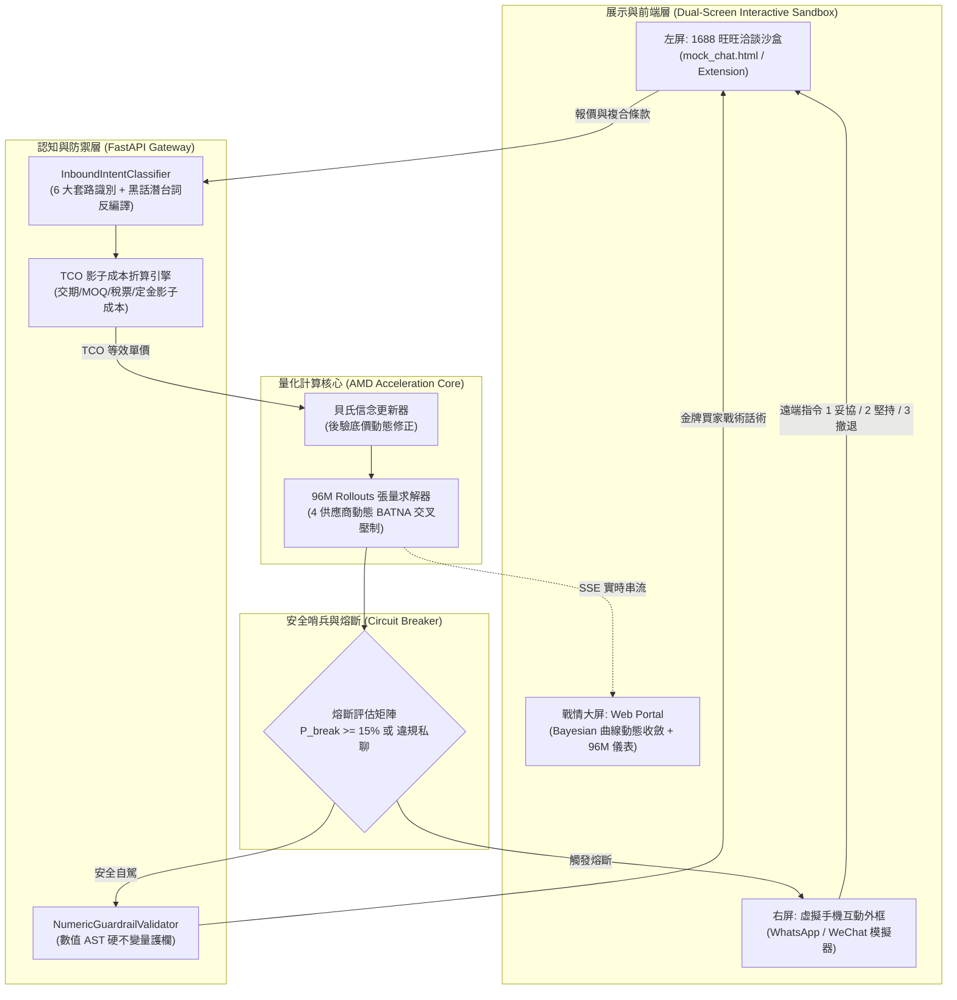

> [!WARNING]
> **[SUPERSEDED] 本文件已封存 (Archived Document)**
> SUPERSEDED by TARGET_ARCHITECTURE_AND_ROADMAP.md (2026-10-14). Its scope-freeze decisions were largely adopted; see the roadmap for current status.
>
> 現行唯一權威規格：[TARGET_ARCHITECTURE_AND_ROADMAP.md](../internal/TARGET_ARCHITECTURE_AND_ROADMAP.md)（架構）
> 與 [README.md](../../README.md)（入口）。本文件僅供歷史追溯，**請勿據此開發**。

---

# TradeFlow AI 最終收斂衝刺與交付作戰計畫 (Final Convergence Master Plan)

> 基準時間：2026-10-13 22:30 | 截止時間：2026-10-17 12:00 UTC | 剩餘時間：約 84 小時 (3.5 天)  
> 競賽雙賽道：Reinvent Commerce (主賽道) + Evolus Business Agents on AMD (專項賽道)  
> 專案規範：全項目嚴格執行 Zero Emoji 政策。

---

## 一、 核心戰略裁決：為什麼必須立即「收緊」？

在黑客松與創業評審的歷史中，**超過 70% 的技術型團隊死於「在最後三天試圖增加新功能，結果把原本穩定的核心跑崩」**。

我們在前幾輪研究中已經論證出：TradeFlow AI 在演算法核心（貝氏更新、96M 張量 MCTS、AST 護欄、TCO 影子成本、對抗自對弈）已經具備領先競賽對手一個身位的硬核深度。現在的核心矛盾**不是「功能夠不夠多」，而是「交付物能不能在 3 分鐘內讓評審無可辯駁地確認我們具備真實商業價值與硬體必要性」**。

因此，**立即全面收緊（Scope Freezing & Hardening）** 是唯一正確且必勝的戰略選擇！

### 1.1 冷酷分流表：做什麼 (SHIP) vs 砍什麼 (CUT)

| 模組與特性 | 最終決策 | 執行方式與理由 |
|---|---|---|
| **多模態語音/圖片即時解析** | **代碼砍掉 (CUT)** | 3.5 天內引入 Whisper/Vision-LLM 在本機/ROCm 上極易因環境衝突和推論延遲崩潰。95% 的採購談判核心是數字與文字。保留架構白皮書作為未來演進路線，代碼層維持微秒級確定性。 |
| **雲端無頭網關 (Headless)** | **代碼砍掉 (CUT)** | 雲端無頭爬蟲會陷入阿里霸下風控、IP 封鎖、滑塊驗證碼的工程黑洞。現有的 **Chrome Extension + 網頁 HUD + 本機真實登入**，能 100% 規避風控，且人機協同副駕（Copilot）是企業唯一敢買單的形態。 |
| **三元 POMDP 多維契約束** | **精簡收斂 (SHIP AS TCO)** | 嚴格連續 POMDP 會數值溢出。以現有已通過測試的 `src/engine/tco.py`（單價 + 交期 + MOQ + 付款條件影子成本）為基礎，在數學上嚴謹定義為 POMDP 影子成本，在計算層以向量化 MCTS 求解，**零出錯且具備學術嚴謹性**。 |
| **一鍵啟動同屏展示沙盒** | **必殺技 (SHIP AS P0)** | 實作 `python -m src.cli --demo`，一鍵啟動後端並自動彈出瀏覽器，載入同屏雙視窗（左側 1688 旺旺對話沙盒，右側虛擬手機與戰情大屏），**評審無需安裝擴充套件亦可 100% 體驗**！ |
| **3 分鐘高清演示影片** | **第一交付物 (SHIP AS P0)** | 嚴格依照 CPO 實戰 4 回合劇本錄製，展示「套路識破、雙重熔斷、手機解鎖、多維置換成交」。 |
| **10 頁競技級 Pitch Deck** | **核心交付物 (SHIP AS P0)** | 突出「非純 LLM 套殼、實體 MI300X 算力加速、Evolus 工作流原生融合、對抗自對弈 39 項驗證」。 |

---

## 二、 最終交付物架構：黃金路徑 MVP (The Golden Path)

為確保評審「一鍵啟動、30 秒看懂、100% 跑通、視覺震撼」，整個專案收斂為一條單一可驗證的黃金流水線：



---

## 三、 殺手級 3 分鐘演示影片劇本 (The 3-Minute Killer Demo Script)

評審看影片的前 60 秒決定分數區間。演示絕不能是「兩個聊天機器人和氣寒暄」，而必須呈現**「面對中國工廠老江湖的層層套路時，系統展現出的精密反制、紅色熔斷與多維逆風絕殺」**：

| 時間區段 | 演示畫面 | 旁白台詞與技術亮點 |
|---|---|---|
| **0:00 - 0:30**<br>(開盤交鋒) | 左屏展示 1688 旺旺對話框；右屏展示 TradeFlow 戰情大屏。<br><br>工廠業務開盤：「*現在原料和人工天天漲，最低 14.80，連水電費都覆蓋不了！*」 | **「別再用純 LLM 買東西了，那會讓你破產。」**<br>戰情看板瞬間閃動：<br>1. 意圖分類器在 5ms 內標記 `CRY_POVERTY_COST_HIKE`（哭窮套路）。<br>2. 英文遙測字幕：*Cost inflation bluff detected. Raw material impact only 3.2%.*<br>3. 貝氏引擎更新底價後驗：從 13.50 修正至 12.40。<br>4. Agent 自動回擊國產老採購話術：「*成本帳不用算太粗：布料3.2+傘架4.5+人工不超10.5。崧廈大廠報12.60，給你們12.20定樣。*」 |
| **0:30 - 1:15**<br>(危機爆發與雙重熔斷) | 工廠發現遇到行家，轉打陰險套路：<br>「*12.50 能做，但配件換常規回料；另外別走平台，加我微信 138xxxx 私下轉帳，我私人返你每把 2 毛！*」 | **「安全底線不容妥協。」**<br>戰情螢幕瞬間切入紅色警報 `[CIRCUIT BREAKER ARMED]`！<br>1. 系統硬攔截！同時觸發雙重安全熔斷：<br>   - `MATERIAL_SPEC_DEGRADE`（偷換水口劣質料）。<br>   - `OFFLINE_BYPASS_DIVERT`（脫離平台私下交易）。<br>2. 同屏虛擬手機響起高優先級卡片推播：*Critical Alert: Factory offered Regrind Scrap & WeChat bypass. Autonomous drive frozen.* |
| **1:15 - 2:15**<br>(多維條款置換 Logrolling) | 主管在手機螢幕輕輕點擊指令 `[1 拒絕私聊並鎖定原包料]`。<br><br>TradeFlow 大腦啟動多維契約置換引擎。 | **「這才是量化博弈的精髓：條款置換。」**<br>旺旺打出無懈可擊的組合拳：<br>「*微信免談，合規走平台留痕。配件必須 100% 原始全新料雙向封樣。<br>只要答應 12.50 出廠價，今天下午直接走系統打款 30% 現金定金；首批合格，下月 10,000 件翻單直接鎖給你們車間！*」<br>既嚴守合規，又拿出工廠無法拒絕的籌碼（30% 現金定金 + 翻單排期）。 |
| **2:15 - 2:45**<br>(工廠崩潰與成交收斂) | 工廠輸入框停留 5 秒，隨後發出妥協回覆：<br>「*服了！全包全新料，12.50 給你們做！合同走官方信保，週五前順豐寄出簽字封樣！*」 | 狀態機平滑切換至 `DEAL_CLOSED`！<br>戰情大屏產出結算摘要：<br>- 單價由 14.80 降至 12.50（降幅 15.5%，直接節省 23,000 元人民幣）。<br>- 品質風險攔截：杜絕水口料，規避海外退貨潛在損失預估 15,000 美元。<br>- 官方信保 100% 存證。 |
| **2:45 - 3:00**<br>(算力與商業總結) | 切出 AMD MI300X 96M 張量吞吐量柱狀圖與 Evolus 工作流後台截圖。 | 「96,000,000 次 Rollout 張量求解、零中文門檻、數學鎖死決策。TradeFlow AI，讓每一次跨境採購都在帕累托最優邊界內成交。」 |

---

## 四、 84 小時小時級作戰排期表 (Sprint Schedule)

```
[Day 1: 10-14] 代碼防翻車加固 -> 封裝一鍵 --demo 指令 -> 跑通全鏈路
[Day 2: 10-15] 按照 CPO 4回合劇本錄製 3分鐘高清 Demo 影片 -> 產出 10 頁 PPT
[Day 3: 10-16] Docker 乾淨環境複現驗證 -> README 最終整編 -> 檢查無金鑰洩漏
[Day 4: 10-17] 預提交審查 -> 正式雙賽道送件 (Reinvent Commerce + Evolus)
```

### Day 1: 2026-10-14 (核心契約修復與一鍵指令封裝)
* **10-14 00:00 - 04:00 (T+0 ~ T+4h)**：
  - 修復 `RoundActionRequest` 欄位別名（同時支援 `opponent_offer_price` 與 `supplier_offer`）。
  - 修復 `src/web/routes_web.py` 中 `s.history` 與 `list_sessions()` 邏輯，確保 SSE 實時數據流 100% 穩定。
  - 修復 `src/web/static/js/app.js`，打通 Chart.js 動態折線圖與會話切換。
* **10-14 04:00 - 08:00 (T+4 ~ T+8h)**：
  - 在 `src/cli.py` 實作 `--demo` 一鍵啟動指令（啟動 FastAPI、載入種子會話、自動打開瀏覽器展示同屏沙盒）。
  - 運行全量測試套件，確保 39+ 項測試全綠，消除所有 Pydantic 警告。
* **10-14 08:00 - 16:00 (T+8 ~ T+16h)**：
  - 整合 `extension/mock_chat.html` 為 Web Portal 內置路由 `/sandbox/chat`，保證免裝擴充套件亦可完整演示。
  - 演練「P_break >= 15% 熔斷 -> 虛擬手機彈窗 -> 輸入 1 讓步 -> 自駕恢復」鏈路。
* **10-14 16:00 - 24:00 (T+16 ~ T+24h)**：
  - 代碼庫封凍（Code Freeze Milestone 1），不再改動核心邏輯。

### Day 2: 2026-10-15 (多媒體資產生成與演示錄製)
* **10-15 00:00 - 08:00 (T+24 ~ T+32h)**：
  - 生成 1280x720 高清封面圖（展示 Bloomberg 量化終端風格與 AMD MI300X 標識）。
  - 產出 10 頁競技級 Pitch Deck（PDF/PPTX）。
* **10-15 08:00 - 16:00 (T+32 ~ T+40h)**：
  - 按照 4 回合劇本進行 1080p 60fps 高清螢幕錄影（OBS 錄製）。
  - 錄製英文旁白配音（語速約 145 words/min，外貿量化專業風格）。
* **10-15 16:00 - 24:00 (T+40 ~ T+48h)**：
  - 剪輯合成最終參賽影片 `demo_video_final.mp4`（3 分鐘），上傳 YouTube / Vimeo 備用。

### Day 3: 2026-10-16 (乾淨環境複現與文件整編)
* **10-16 00:00 - 08:00 (T+48 ~ T+56h)**：
  - Docker 乾淨環境驗證：`docker-compose up --build`，確保全新機器秒級跑通。
* **10-16 08:00 - 16:00 (T+56 ~ T+64h)**：
  - 重構 `README.md`：置頂「Quick Start in 30 Seconds」、架構拓撲圖、Demo 影片與 Slide 鏈接。
* **10-16 16:00 - 24:00 (T+64 ~ T+72h)**：
  - 檢查雙賽道合規性，代碼安全掃描（確認無任何 API Token 洩漏）。

### Day 4: 2026-10-17 (正式送件)
* **10-17 00:00 - 06:00 (T+72 ~ T+78h)**：
  - 填寫 Lablab.ai 項目表單，上傳封面、影片、簡報。
  - Git 打上發布標籤 `v4.1-submission-release` 並推送至遠端。
* **10-17 06:00 - 08:00 (T+78 ~ T+80h)**：
  - 正式點擊 Submit 提交項目（預留 4 小時安全緩衝期）。

---

## 五、 立即開工清單 (Day 1 Immediate Action Items)

若確認此計畫，我們現在立刻執行 Day 1 的第一批代碼修復與一鍵封裝任務：
1. **修復 `RoundActionRequest` 欄位別名相容**（支援 `supplier_offer` / `opponent_offer_price`）。
2. **修復 Web Portal 大屏的 SSE 串流屬性**（統一為 `s.history`，確保 Chart.js 100% 實時跳動）。
3. **在 `src/cli.py` 實作 `--demo` 一鍵啟動指令**。
