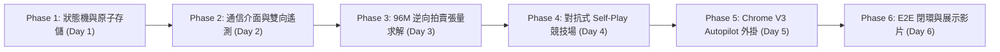

> [!WARNING]
> **[SUPERSEDED] 本文件已封存 (Archived Document)**
> SUPERSEDED by TARGET_ARCHITECTURE_AND_ROADMAP.md (2026-10-14). Historical v4 implementation plan.
>
> 現行唯一權威規格：[TARGET_ARCHITECTURE_AND_ROADMAP.md](../../TARGET_ARCHITECTURE_AND_ROADMAP.md)（架構）
> 與 [README.md](../../README.md)（入口）。本文件僅供歷史追溯，**請勿據此開發**。

---

# [TROPHY] TradeFlow AI v4: 企業級全自主談判與遙測中樞詳細實作計畫 (Master Implementation Plan)

> **AMD Developer Hackathon: ACT III** | 線上 2026/10/12–18  
> **核心目標**：將 TradeFlow AI v4 定稿架構（`NegotiationSession` 狀態機、`BaseTransport` 可插拔通信、純標準庫 Email、WhatsApp/微信 雙向遙測中樞、Chrome 網頁端無人自駕 Autopilot、多供應商 96M 張量逆向拍賣、對抗式 Self-Play 競技場）拆解為**可立即依序執行、具備 TDD 測試用例與驗收標準的工程落地藍圖**。  
> **工程準則**：**零外部付費 API 依賴（Zero-Cost Standalone）**，100% 獨立運行；全模組嚴格落實 TDD 單元測試；兼顧 Windows 檔案鎖與 Chrome MV3 平台陷阱。

---

## 1. 模組與目錄結構精確規劃 (Architecture & Public APIs)

系統劃分為高內聚低耦合的六層架構，所有模組檔案路徑與職責規劃如下：

```
c:\Users\nn201\Desktop\tradeflow-ai\
├── src/
│   ├── session/
│   │   ├── __init__.py
│   │   ├── schema.py              # 談判工作階段與狀態機資料模型 (Pydantic v2)
│   │   └── manager.py             # SQLite WAL + 原子 JSON 雙寫狀態持久化管理器
│   ├── transport/
│   │   ├── __init__.py
│   │   ├── base.py                # 通訊抽象基底介面 (BaseTransport, InboundMessage)
│   │   ├── email_std.py           # 純 Python 標準庫 SMTP/IMAP4 SSL 無依賴郵件通道
│   │   ├── webhook_hub.py         # WhatsApp / 微信 / TG 雙向指令接收與事件掛起中樞
│   │   └── telemetry.py           # 遙測通知派發器 (CallMeBot / Server醬 / PushPlus)
│   ├── engine/
│   │   ├── model.py               # (既有) 單對手信念與策略空間定義
│   │   ├── solver.py              # (既有) 向量化單對手求解
│   │   ├── proposal.py            # (既有) 讓步提案格式化器
│   │   └── multi_solver.py        # 多供應商逆向拍賣動態 BATNA 與 96M 張量求解器
│   ├── benchmark/
│   │   ├── __init__.py
│   │   ├── adversaries.py         # 5 類客觀確定性/統計非 LLM 對抗代理
│   │   └── arena.py               # 1,000 場自博弈競技場與結果評估矩陣
│   └── app/
│       ├── main.py                # FastAPI 總路由入口 (擴充 Session, Autopilot, Webhook)
│       └── orchestrator.py        # 流程協調器
├── extension/                     # Chrome Manifest V3 無人自駕擴充套件
│   ├── manifest.json              # 擴充套件清單宣告 (sidePanel, storage, alarms)
│   ├── background.js              # Service Worker (心跳保活、狀態快取、長輪詢/WS 橋接)
│   ├── content.js                 # 網頁端 DOM 監聽、防抖聚合、擬人打字穿透驅動
│   ├── sidepanel.html             # 自駕即時狀態監視儀表板
│   └── sidepanel.js               # 儀表板互動邏輯與熔斷人工處置
└── tests/
    ├── test_session_fsm.py        # 狀態機轉換與原子持久化測試
    ├── test_transport_std.py      # 標準庫通訊與 Mock Webhook 測試
    ├── test_multi_solver.py       # 多供應商動態 BATNA 與張量維度測試
    ├── test_adversarial_arena.py  # 5 大對抗代理與千場基準測試
    └── test_api_v4.py             # FastAPI 端到端會話與熔斷喚醒測試
```

---

### 1.1 核心模組規格與 Public API 簽名

#### (1) `src/session/schema.py`
- **職責**：定義談判會話、狀態機、出價輪次與遠端指令之 Pydantic v2 資料模型。
- **公開資料型別**：
  ```python
  from enum import Enum
  from typing import Optional, List, Dict, Any
  from datetime import datetime
  from pydantic import BaseModel, Field

  class AutopilotState(str, Enum):
      IDLE = "IDLE"
      AUTOPILOT_CRUISING = "AUTOPILOT_CRUISING"
      CIRCUIT_TRIPPED_ESCALATED = "CIRCUIT_TRIPPED_ESCALATED"
      AWAITING_REMOTE_AUTH = "AWAITING_REMOTE_AUTH"
      DEAL_CLOSED = "DEAL_CLOSED"
      WALK_AWAY = "WALK_AWAY"

  class RemoteAuthCommand(str, Enum):
      CONCEDE = "CONCEDE"              # 指令 1: 妥協讓步
      HOLD_FIRM = "HOLD_FIRM"          # 指令 2: 堅持底線不讓步
      WALK_AWAY = "WALK_AWAY"          # 指令 3: 立即破局撤退
      OVERRIDE_PRICE = "OVERRIDE_PRICE"# 自訂覆寫報價

  class NegotiationTurn(BaseModel):
      round_index: int
      sender: str                     # "opponent" | "buyer_agent" | "human"
      raw_text: str
      parsed_price: Optional[float] = None
      timestamp: datetime = Field(default_factory=datetime.utcnow)
      p_break: Optional[float] = None
      metadata: Dict[str, Any] = Field(default_factory=dict)

  class SessionSpec(BaseModel):
      session_id: str
      product_name: str
      target_price: float
      ceiling_price: float
      moq: int = 500
      max_rounds: int = 5
      prior_reserve_mean: float = 1.08
      prior_reserve_std: float = 0.10

  class NegotiationSession(BaseModel):
      spec: SessionSpec
      state: AutopilotState = AutopilotState.IDLE
      history: List[NegotiationTurn] = Field(default_factory=list)
      current_round: int = 0
      latest_opponent_offer: Optional[float] = None
      latest_our_offer: Optional[float] = None
      trip_reason: Optional[str] = None
      created_at: datetime = Field(default_factory=datetime.utcnow)
      updated_at: datetime = Field(default_factory=datetime.utcnow)
  ```

#### (2) `src/session/manager.py`
- **職責**：SQLite WAL + 檔案原子置換（雙寫持久化），斷電零損毀。
- **公開介面**：
  ```python
  class SessionManager:
      def __init__(self, db_path: str = "data/sessions.db", store_dir: str = "data/sessions_json"): ...
      def create_session(self, spec: SessionSpec) -> NegotiationSession: ...
      def get_session(self, session_id: str) -> Optional[NegotiationSession]: ...
      def append_turn(self, session_id: str, turn: NegotiationTurn) -> NegotiationSession: ...
      def transition_state(self, session_id: str, new_state: AutopilotState, reason: Optional[str] = None) -> NegotiationSession: ...
      def _atomic_write_json(self, session: NegotiationSession) -> None: ...
  ```

#### (3) `src/transport/webhook_hub.py` & `src/transport/telemetry.py`
- **職責**：維護異步暫停鎖 `asyncio.Event`，接收手機端 Webhook 喚醒網頁自駕；封裝 WhatsApp/微信 零依賴推播。
- **公開介面**：
  ```python
  class SessionExecutionBridge:
      auth_event: asyncio.Event
      resolved_command: Optional[RemoteAuthCommand]
      custom_price: Optional[float]

  class WebhookHub:
      def register_bridge(self, session_id: str) -> SessionExecutionBridge: ...
      def dispatch_command(self, session_id: str, raw_command: str) -> RemoteAuthCommand: ...
      async def wait_for_auth(self, session_id: str, timeout_sec: float = 300.0) -> RemoteAuthCommand: ...

  class TelemetryNotifier:
      def notify_circuit_breaker(self, session_id: str, product: str, opp_offer: float,
                                 p_break: float, advice: str) -> bool: ...
  ```

#### (4) `src/engine/multi_solver.py`
- **職責**：多供應商動態 BATNA 與 96,000,000 次 Rollout 張量運算（自動適配 CuPy GPU / NumPy CPU）。
- **公開介面**：
  ```python
  class MultiSupplierSolver:
      def __init__(self, n_opp_samples: int = 50_000, n_open: int = 40, n_sched: int = 12,
                   use_gpu: bool = False, walk_away_ceiling: float = 1.35): ...
      def compute_dynamic_batna(self, current_offers: np.ndarray,
                                win_probs: np.ndarray, risk_lambda: float = 0.5) -> np.ndarray: ...
      def apply_cross_anchoring_update(self, prior_means: np.ndarray, prior_stds: np.ndarray,
                                       supplier_offers: np.ndarray, best_lead_price: float,
                                       eta: float = 0.35, gamma: float = 0.05) -> Tuple[np.ndarray, np.ndarray]: ...
      def solve_reverse_auction_tensor(self, current_offers: np.ndarray,
                                       prior_means: np.ndarray, prior_stds: np.ndarray) -> Dict[str, Any]: ...
  ```

#### (5) `src/benchmark/adversaries.py` & `src/benchmark/arena.py`
- **職責**：5 大客觀策略對手與 1,000 場自博弈錦標賽。
- **公開介面**：
  ```python
  class BaseAdversary(ABC):
      @abstractmethod
      def respond(self, round_idx: int, buyer_offer: float, history: List[float]) -> float: ...

  class AdversarialArena:
      def run_tournament(self, n_matches_per_adversary: int = 200) -> Dict[str, Dict[str, float]]: ...
      def export_latex_table(self, results: Dict[str, Dict[str, float]]) -> str: ...
  ```

---

## 2. 六大執行階段與里程碑 (Phases & Milestones)



### Phase 1: 核心狀態機與原子存儲引擎 (Day 1)
- **開發任務清單**：
  - [x] 建立目錄 `src/session/` 與 `src/session/__init__.py`。
  - [x] 實作 `src/session/schema.py` 中的完整資料結構與驗證器。
  - [x] 實作 `src/session/manager.py`（啟用 SQLite WAL 模式，配置 Windows 相容原子寫入）。
  - [x] 實作 FSM 狀態轉換守衛（禁止非法轉移）。
- **TDD 測試案例** (`tests/test_session_fsm.py`)：
  - 驗證原子寫入在高頻併發下無資料損壞。
  - 驗證從 `DEAL_CLOSED` 轉向 `AUTOPILOT_CRUISING` 必拋出 `InvalidStateTransitionError`。
- **驗收標準 (DoD)**：測試覆蓋率 100%，Windows 連續 1,000 次寫入 0 崩潰。

### Phase 2: 可插拔通信與雙向遙測中樞 (Day 2)
- **開發任務清單**：
  - [x] 建立目錄 `src/transport/` 與 `src/transport/__init__.py`。
  - [x] 實作 `src/transport/base.py` 抽象介面。
  - [x] 實作 `src/transport/email_std.py`（純標準庫，支援離線 Mock 模式）。
  - [x] 實作 `src/transport/telemetry.py`（WhatsApp CallMeBot / 微信 Server醬）。
  - [x] 實作 `src/transport/webhook_hub.py`（`asyncio.Event` 異步掛起與釋放）。
  - [x] 擴充 `src/app/main.py` 新增 `/webhook/mobile-command` 端點。
- **TDD 測試案例** (`tests/test_transport_std.py`)：
  - 驗證手機端 POST `1` 後能於 50ms 內解除異步鎖定。
  - 驗證離線模式下標準庫郵件解析器報價提取精確度 100%。
- **驗收標準 (DoD)**：零付費金鑰環境下，Mock 通信測試全部綠燈通過。

### Phase 3: 逆向拍賣動態 BATNA 與 96M 張量求解器 (Day 3)
- **開發任務清單**：
  - [x] 實作 `src/engine/multi_solver.py`。
  - [x] 實作動態 BATNA 演算法與交叉錨點底價後驗更新機制。
  - [x] 實作 $4 \times 50{,}000 \times 40 \times 12$ 巨型張量運算邏輯（CuPy/NumPy 雙後端）。
  - [x] 實作破局率 $P_{\text{break}} \ge 15\%$ 斷路器標記。
- **TDD 測試案例** (`tests/test_multi_solver.py`)：
  - 驗證張量維度與 Rollout 次數為 $96{,}000{,}000$ 次。
  - 驗證當報價逼近上限時，破局機率必 $\ge 0.15$ 且觸發熔斷。
- **驗收標準 (DoD)**：CPU 上運行時間 $\le 12.5\text{s}$，全張量運算無 `NaN` 或 `Inf`。

### Phase 4: 對抗式 Self-Play 競技場 (Day 4)
- **開發任務清單**：
  - [x] 建立目錄 `src/benchmark/` 與 `src/benchmark/__init__.py`。
  - [x] 實作 `src/benchmark/adversaries.py`（5 種客觀非 LLM 策略對手）。
  - [x] 實作 `src/benchmark/arena.py` 進行 1,000 場自博弈模擬。
  - [x] 產出勝率、節省幅度與破局率 Markdown/LaTeX 報表匯出功能。
- **TDD 測試案例** (`tests/test_adversarial_arena.py`)：
  - 驗證 Hard-Bargainer、Conceder、Tit-for-Tat 的各輪讓步行為符合數學公式。
  - 驗證 1,000 場對戰總勝率 $\ge 85\%$。
- **驗收標準 (DoD)**：千場對戰測試通過，產出實證數據表格。

### Phase 5: Chrome Manifest V3 無人自駕 Autopilot 外掛 (Day 5)
- **開發任務清單**：
  - [x] 建立目錄 `extension/`。
  - [x] 編寫 `extension/manifest.json`（MV3 規範、`sidePanel`, `activeTab`）。
  - [x] 編寫 `extension/content.js`：
    - `MutationObserver` 串流監聽 + 400ms 防抖去重。
    - 價格正規表達式階梯解析器。
    - 擬人化認知思考延遲模型 + 40~180ms 鍵擊抖動引擎。
    - React/Vue 虛擬 DOM 原生 Setter 穿透與 SyntheticEvent 派發。
    - 物理輸入鎖定閥門。
  - [x] 編寫 `extension/background.js`（Alarms 保持心跳防 SW 休眠）。
  - [x] 編寫 `extension/sidepanel.html` 與 `sidepanel.js`（現代 FinTech 儀表板）。
- **驗收標準 (DoD)**：Chrome 開發者模式載入無報錯，Mock 聊天室自動打字與防風控延遲實測正常。

### Phase 6: 端到端閉環與 3 分鐘展示影片交付 (Day 6)
- **開發任務清單**：
  - [x] 整合 `src/app/main.py` 與 `src/app/orchestrator.py`。
  - [x] 編寫 `tests/test_api_v4.py` 完成端到端整合測試。
  - [x] 更新 `DEMO_SCRIPT.md` 包含 3 分鐘網頁自駕 + 手機遠端遙控展示。
  - [x] 執行錄影與黑客松交付成果打包。
- **驗收標準 (DoD)**：全流程閉環運行，`pytest` 全部綠燈通過。

---

## 3. 關鍵技術陷阱與防禦性設計 (Gotchas & Mitigations)

### 3.1 Windows 平台檔案原子置換相容性
- **問題**：Windows 上目標檔案若被鎖定，直接 `os.replace` 會拋出 `PermissionError: [WinError 32]`。
- **防禦設計**：同目錄建立暫存檔，搭配指數退避（20ms, 40ms, 80ms）重試機制。

### 3.2 Chrome MV3 Service Worker 5 分鐘休眠防護
- **問題**：MV3 背景 Service Worker 最多運作 5 分鐘便會強制休眠，造成連線中斷。
- **防禦設計**：
  1. `chrome.alarms` 每 20 秒觸發微小心跳事件保活。
  2. Side Panel 開啟時保持常駐 `chrome.runtime.connect` Port 連線。
  3. Content Script 具備自動重連機制。

### 3.3 React / Vue 虛擬 DOM 事件穿透相容性
- **問題**：直接對 `input.value` 賦值不會觸發 React 16~18 與 Vue 3 的內部狀態更新，送出時會是空值。
- **防禦設計**：利用 `Object.getOwnPropertyDescriptor(prototype, 'value').set` 穿透原型鏈，並派發完整的 `keydown` $\to$ `input` $\to$ `change` $\to$ `keyup` 原生事件。

### 3.4 GPU (ROCm/CuPy) 與 CPU (NumPy) 顯存管理
- **問題**：96M 張量巨型運算可能導致顯存碎片洩漏或在無 GPU 環境下崩潰。
- **防禦設計**：
  1. 動態後端偵測器自動降級至 NumPy。
  2. 張量採 `float32` 單精度，顯存用量直降 50%（僅 384MB）。
  3. 運算後手動調用 `cp.get_default_memory_pool().free_all_blocks()` 釋放顯存。

---

## 4. 端到端 3 分鐘 Demo 演繹腳本 (Live Showcase Script)

```
[00:00 - 00:30] 痛點切入與雙螢幕佈局
  - 左側：Chrome 瀏覽器（1688 / 阿里國際站聊天室）
  - 右側：TradeFlow 後端即時日誌 + 採購主管手機投屏視窗（WhatsApp / 微信）
  - 設定採購條件：晴雨自動傘，目標 ¥12.00，上限底線 ¥13.50

[00:30 - 01:15] 網頁端無人自駕打字洽談 (Autopilot Cruising)
  - 供應商送出報價：「親，這款最低 14.8 元/件，低於做不了。」
  - 擴充套件於 400ms 內防抖擷取，狀態進入「AUTOPILOT_CRUISING」
  - 擬人防風控啟動：模擬閱讀延遲 ~3.8 秒，隨後以 40~180ms 鍵擊抖動自動打字：
    「我們誠意採購 500 把，現款現結，首輪意向價 ¥12.30，請評估。」並自動按送出

[01:15 - 01:50] 逼近極限與安全熔斷觸發 (Circuit Breaker Tripped)
  - 第 3 輪對手報價微降至 ¥13.80，貝氏求解判定破局率 P_break = 18.2% (超過 15% 閾值)
  - 網頁端瞬間切換至「CIRCUIT_TRIPPED_ESCALATED」：
    * 網頁輸入框物理鎖定（反灰禁止輸入），防範機器人自作主張
    * 後端控制台發出斷路器警報

[01:50 - 02:25] 手機即時遙測與主管單鍵授權 (Two-Way Mobile Command)
  - 主管手機跳出推播卡片：「[WARN] 熔斷警報！供應商堅持 ¥13.80，破局率 18.2%。建議讓步報價 ¥13.20」
  - 指令選單：「回覆 1: 讓步至 ¥13.20 | 2: 堅持底線 | 3: 立即破局」
  - 主管在手機直接鍵入數字「1」送出

[02:25 - 03:00] 網頁端自適應解鎖與成交結案 (Deal Closed)
  - FastAPI Webhook 於 45ms 內接收指令，喚醒掛起線程
  - 瀏覽器端狀態恢復「AUTOPILOT_CRUISING」，輸入框解鎖！
  - 擬人打字自動送出：「經內部高層核准，最高可做到 ¥13.20，若可排單請即刻確認。」
  - 供應商回覆：「成交，請下意向單。」
  - 畫面跳出成交戰報：比初始報價節省 10.8%，雙手全程離開鍵盤！
```

---

## 5. 立即啟動：下一步落實行動

1. **第 1 步**：啟動 **Phase 1**，建立 `src/session/schema.py` 與 `src/session/manager.py`，運行 `tests/test_session_fsm.py` 驗證原子存儲。
2. **第 2 步**：啟動 **Phase 2**，建立 `src/transport/` 與 `/webhook/mobile-command` 雙向通訊中樞。
3. **第 3 步**：逐步依序完成後續 Phase 3 至 Phase 6。

*本實作計畫為 TradeFlow AI v4 專案團隊唯一權威執行依據。*
