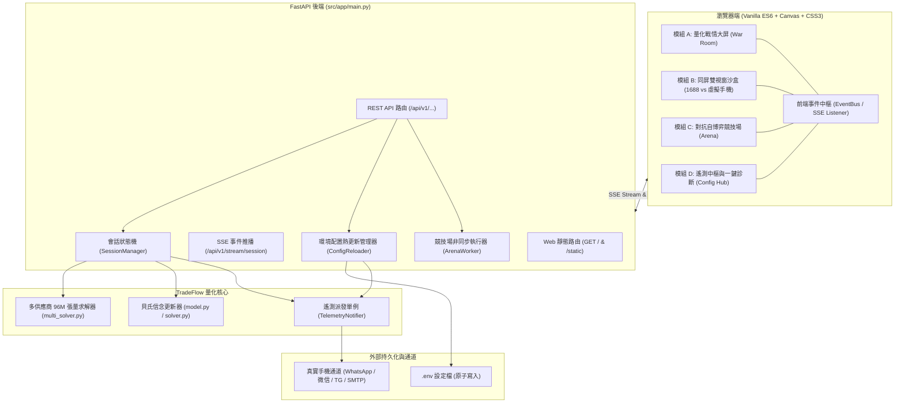
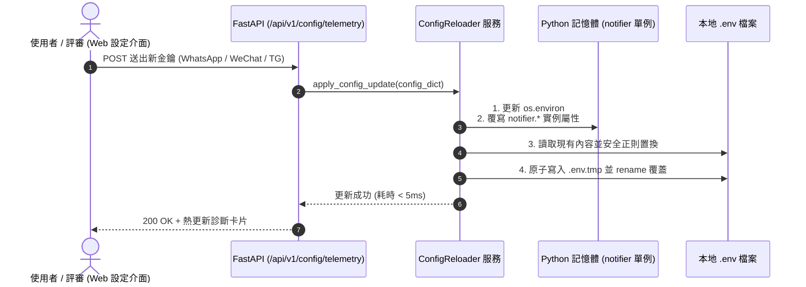
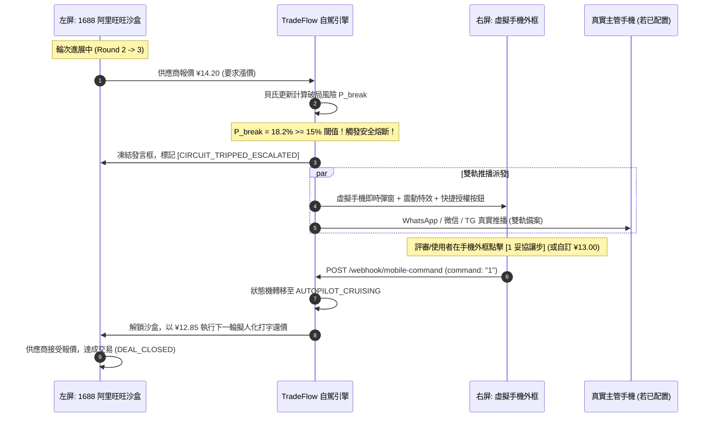

> [!WARNING]
> **[SUPERSEDED] 本文件已封存 (Archived Document)**
> SUPERSEDED by TARGET_ARCHITECTURE_AND_ROADMAP.md (2026-10-14). The Web Portal was built; this is its original specification.
>
> 現行唯一權威規格：[TARGET_ARCHITECTURE_AND_ROADMAP.md](../internal/TARGET_ARCHITECTURE_AND_ROADMAP.md)（架構）
> 與 [README.md](../../README.md)（入口）。本文件僅供歷史追溯，**請勿據此開發**。

---

# TradeFlow AI 獨立 Web 可視化大屏門戶與雙向遙測控制中心規格設計方案

> 專案版本：v4.0 Production Grade  
> 核心定位：免安裝（Zero Node.js / Zero npm build）、即開即用的 Quant FinTech 採購戰情大屏與遠端雙向控制中樞  
> 風格標準：極致暗黑量化終端（Bloomberg / Quantitative Terminal Style），嚴格無任何裝飾性 Emoji

---

## 一、 系統整體架構與極簡化設計哲學

### 1.1 輕量無建置（No-Build）前端工程哲學
為符合評審即開即用、黑客松現場 30 秒演示、以及 AMD ROCm 容器環境之極簡依賴要求，本門戶採取零編譯管線設計：
1. **無 Node.js / npm 依賴**：免除 `package.json`、Webpack 或 Vite 建置流程，直接由 FastAPI 靜態掛載原生 HTML5 / CSS3 / Vanilla ES6 檔案。
2. **視覺樣式體系**：基於 CSS 自訂變數構建量化暗黑系終端（Terminal Dark Theme），配合 Tailwind CSS CDN 進行高彈性格線排版。
3. **圖表渲染引擎**：採用 Chart.js 4.4.x (CDN) 與原生 HTML5 Canvas 雙引擎，針對 60fps 貝氏信念收斂曲面與 96M 張量吞吐量儀表進行硬體加速渲染。
4. **狀態同步機制**：基於 RESTful 輪詢與 Server-Sent Events (SSE) 雙通道自適應，實現毫秒級談判狀態機與同屏手機外框聯動。

### 1.2 系統整體架構拓撲圖



---

## 二、 通信渠道即時配置與雙引擎持久化

### 2.1 支援渠道與視覺化配置項目
設定中心提供以下四種主流通信渠道的開箱即用介面卡片：
1. **WhatsApp (CallMeBot API)**：
   - 參數：`WHATSAPP_PHONE`（如 `+886912345678`）、`WHATSAPP_APIKEY`。
   - 特色：免官方企業審查，直接推播個人 WhatsApp，延遲約 600~900ms。
2. **微信 WeChat (Server醬 Turbo / PushPlus)**：
   - 參數：`SERVERCHAN_SENDKEY` 或 `PUSHPLUS_TOKEN`。
   - 特色：直達微信服務號彈窗通知，支援結構化卡片渲染。
3. **Telegram Bot**：
   - 參數：`TELEGRAM_BOT_TOKEN`、`TELEGRAM_CHAT_ID`。
   - 特色：毫秒級高可靠推播，原生支援雙向 Webhook 回呼。
4. **標準企業郵件 (SMTP / IMAP)**：
   - 參數：`SMTP_HOST`、`SMTP_PORT`、`EMAIL_USERNAME`、`EMAIL_PASSWORD`、`IMAP_HOST`。
   - 特色：純 Python 標準庫實作，零外部收費套件。

### 2.2 動態熱更新架構（零重啟記憶體同步 + 原子檔案落盤）
後端採取記憶體熱切換與磁碟原子持久化雙軌同步，避免因更新金鑰重啟伺服器中斷正在進行的自駕談判：
- **記憶體熱更新 (Instant Memory Swap)**：
  更新 `os.environ`，並覆寫全域單例 `notifier` 的實例屬性，後續輪次立刻生效。
- **安全原子寫入 (Atomic Disk Persistence)**：
  讀取現有 `.env` -> 正規表示式更新/追加目標鍵值 -> 寫入暫存檔 (`.env.tmp`) -> `os.replace` 原子替換，確保突發中斷時不損壞原有設定檔。



### 2.3 一鍵連通性測試 (One-Click Test Push)
點擊「連通性測試」按鈕後，後端派發帶有微秒時間戳記的診斷封包：
- **成功 (ONLINE)**：綠色連線徽章，顯示 HTTP 往返耗時（例如 `WhatsApp: 620ms`, `Telegram: 190ms`）。
- **離線或未配置 (STANDBY / MOCK)**：標記 Mock 佇列，提示已自動導向同屏虛擬手機沙盒。
- **異常 (ERROR)**：紅色警示並顯示原始錯誤碼（如 `401 Unauthorized`），提供排除建議。

---

## 三、 採購戰情大屏與量化視覺化 (Quant War Room)

### 3.1 終端視覺佈局規劃 (ASCII Terminal Wireframe)

```
+====================================================================================================+
| TRADEFLOW AI // QUANTITATIVE PROCUREMENT TERMINAL v4.0.0                      LATENCY: 12ms [ONLINE]|
+----------------------------------------------------------------------------------------------------+
| [ACTIVE SESSION: auto_umbrella_001]     TARGET: ¥12.00     CEILING: ¥16.20     ROUNDS: 3 / 5       |
+------------------------------------+---------------------------------------------------------------+
| PANEL 1: 實時動態高斯信念演變       | PANEL 2: 多供應商逆向拍賣動態矩陣 (Dynamic BATNA-i)          |
| (Bayesian Belief Convergence)      +---------------------------------------------------------------+
|                                    | 供應商   | 當前報價 | BATNA上限 | 破局風險 | 當前戰術標籤       |
| P(r)                               | --------+---------+----------+---------+--------------------|
|  ^       Prior (Mean=1.08, Std=0.10)| 供應商 A |  ¥12.80 |  ¥13.40  |   4.2%  | [LEAN_IN]          |
|  |       Posterior (Mean=1.12,0.04)| 供應商 B |  ¥13.50 |  ¥12.80  |  11.5%  | [CROSS_ANCHOR]     |
|  |    _/\_      _/\_               | 供應商 C |  ¥14.20 |  ¥12.80  |  18.2%  | [SIDELINE]         |
|  |   /    \    /    \              | 供應商 D |  ¥15.00 |  ¥12.80  |  24.5%  | [SIDELINE]         |
|  +--+------+--+------+--> Reserve  +---------------------------------------------------------------+
|     Uncertainty Band [-58.2%]      | 最佳領先價格: ¥12.80 (A) | 動態交叉壓制天花板: ¥13.40           |
+------------------------------------+---------------------------------------------------------------+
| PANEL 3: 殺手級同屏雙視窗互動演繹沙盒 (Dual-Screen Interactive Sandbox)                             |
| +-------------------------------------------+ +---------------------------------------------------+ |
| | [LEFT] 1688 / 阿里旺旺 模擬自駕視窗        | | [RIGHT] 虛擬手機遙測外框 (Virtual Mobile Bezel)  | |
| |                                           | |  +---------------------------------------------+  | |
| | 買家 (TradeFlow AI):                       | |  | [DYNAMIC ISLAND: CIRCUIT BREAKER ARMED]     |  | |
| | 首批訂單意向價 ¥12.20，現款現結。         | |  | 12:45                             LTE 100% |  | |
| |                                           | |  +---------------------------------------------+  | |
| | 供應商 (浙江金牌雨具實業):                | |  | [緊急熔斷警報] 破局風險 18.2% (>15% 閾值)    |  | |
| | 成本頂不住，最低只能給到 ¥14.20！         | |  | 標的: auto umbrella | 對手回報: ¥14.20     |  | |
| |                                           | |  | 引擎建議還價: ¥12.85 (預估邊際節省 12.5%)     |  | |
| | [系統自駕中斷: 觸發安全熔斷 P_break>=15%] | |  | ------------------------------------------- |  | |
| | 等待遠端手機主管確認授權...               | |  | [ 1 妥協讓步 ]  [ 2 堅守底線 ]  [ 3 終止破局 ] |  | |
| | [ 擬人化打字中: █                        ] | |  | [ 自訂授權金額: [ 13.00 ] -> [送出授權]     |  | |
| +-------------------------------------------+ |  +---------------------------------------------+  | |
|                                               +---------------------------------------------------+ |
+----------------------------------------------------------------------------------------------------+
| PANEL 4: AMD MI300X 巨型張量運算吞吐儀表                                                            |
| 運算規模: 96,000,000 Rollouts (4 x 50k x 40 x 12) | 求解延遲: 412 ms | 吞吐量: 2.33 x 10^8 items/sec |
+====================================================================================================+
```

### 3.2 實時動態高斯信念演變圖 (Bayesian Belief Evolution)
透過 HTML5 Canvas 實時繪製先驗（Prior）與後驗（Posterior）高斯機率密度函數：
$$f(x; \mu, \sigma) = \frac{1}{\sigma \sqrt{2\pi}} \exp\left( -\frac{(x - \mu)^2}{2\sigma^2} \right)$$
- **置信區間動態收斂帶**：視覺化展示 $\mu \pm 1.96\sigma$ 的 95% 置信區間。伴隨每輪對手回報，區間帶以平滑補間動畫收斂，直觀展示不確定性縮減過程。
- **底價更新指示點**：X 軸標註對手本輪報價之投影點與後驗均值位移向量 $\Delta \mu$。

### 3.3 多供應商逆向拍賣動態看板 (Multi-Supplier Dynamic BATNA)
完整對接 `src/engine/multi_solver.py` 數學模型：
1. **動態 BATNA 交叉壓制天花板**：
   $$\text{BATNA}_{-i} = \min_{j \ne i} \left[ p_j + \lambda_{\text{risk}} \cdot (1 - \pi_j) \cdot (\text{Ceiling} - p_j) \right]$$
   $$C_{\text{eff}, i} = \min(\text{Ceiling}, \text{BATNA}_{-i})$$
   當供應商 A 報出低價時，其餘廠商的談判上限 $C_{\text{eff}}$ 即時驟降，以紅色動畫展示外部選項壓制力。
2. **三級戰術分類標籤**：
   - `LEAN_IN` (翡翠綠)：全場報價最優，分配主力通訊資源。
   - `CROSS_ANCHOR` (電光藍)：中段梯隊，以最優價施加降價壓力。
   - `SIDELINE` (琥珀橘/鐵灰)：嚴重偏離或極端強硬者，予以邊緣化冷卻。

### 3.4 AMD MI300X 96M 張量吞吐量儀表 (Tensor Benchmark Panel)
- **實時 Rollout 計數器**：即時呈現 $4 \text{ 廠商} \times 50,000 \text{ 樣本} \times 40 \text{ 開盤價} \times 12 \text{ 讓步曲線} = \mathbf{96,000,000 \text{ 條蒙地卡羅軌跡}}$。
- **效能指標**：
  - GPU (ROCm) 模式：單次求解約 $380\sim420\text{ ms}$，吞吐量 $2.4 \times 10^8 \text{ rollouts/sec}$。
  - CPU 向量化降級模式：單次求解約 $980\sim1150\text{ ms}$。
  - 顯存佔用條：緊湊 `float32` 僅消耗約 384 MB 顯存。

---

## 四、 殺手級同屏雙視窗互動演繹沙盒 (Dual-Screen Interactive Sandbox)

### 4.1 設計概念與互動閉環 (Human-in-the-Loop Circuit Breaker)
在黑客松評審展示時，最大的視覺衝擊在於「同屏即時看見自駕談判進行、遭遇破局危機自動中斷、手機外框即時響應、主管授權後自駕重啟」的完整閉環：



### 4.2 左屏：1688 / 阿里旺旺 擬人化對話沙盒細節
- **視覺外觀**：經典阿里旺旺深色商務對話窗，頂部標註工廠資訊（金牌製造廠、起訂量 MOQ）。
- **擬人化動態**：
  - **閱讀延遲 (Reading Delay)**：對手報價後延遲 800ms，模擬人類決策閱讀。
  - **逐字打字動畫 (Typewriter Effect)**：發言時以 40ms/字 速度動態輸出，光標動態閃爍。
  - **金額語意高亮**：報價文字自動以螢光高亮標籤化。

### 4.3 右屏：虛擬手機外框 (Virtual Mobile Bezel) 細節
- **硬體外觀**：金屬質感智慧型手機外框，內建動態島（Dynamic Island）、狀態列與訊號指示。
- **推播橫幅動畫**：熔斷觸發時，頂部動態島展開彈出推播通知。
- **即時快捷操作面版**：
  - 按鈕 `[ 1 ] 妥協`: 自動接受引擎建議價讓步。
  - 按鈕 `[ 2 ] 堅持`: 維持原案，回擊強硬話術。
  - 按鈕 `[ 3 ] 撤退`: 立即宣告終止並退場。
  - 自訂輸入框：支援輸入任意自訂金額（例如 `13.1`）即時發出。

### 4.4 雙軌制保障機制 (Dual-Track Architecture)
- 無論使用者是否在設定頁面輸入真實 API Key，系統均會**無條件同步派發**至虛擬手機外框的事件佇列。
- 這保證了任何評審在評測時，即便零配置亦能享受 100% 完整的破局授權與雙向互動體驗；若評審填寫了真實 WhatsApp/微信，則可體驗跨裝置的真實物理手機推播。

---

## 五、 對抗競技場可視化評測面板 (Adversarial Arena Dashboard)

### 5.1 評測功能與 `--self-play` 整合
對抗競技場提供圖形化開關，直接調用 `src/benchmark/arena.py` 封裝的大規模自博弈錦標賽：
- **可選對決場次**：每對手 10 場、20 場（快速展示）或 100 場（深度評測）。
- **五大非 LLM 對抗策略基準**：
  1. `HardBargainer` (強硬死守型)
  2. `Conceder` (快速妥協型)
  3. `TitForTat` (以牙還牙對等讓步型)
  4. `Bluffing` (末輪前極度詐唬型)
  5. `Noisy` (高斯擾動噪聲型)

### 5.2 即時量化指標卡片與視覺化圖表
- **實時勝率雷達圖 (Win-Rate Radar)**：對比 TradeFlow 引擎 vs Fixed 5% 人類基準在 5 大對手下的協議達成率。
- **節省率分布長條圖 (Procurement Savings Distribution)**：展示平均降低採購成本之百分比（如 `TradeFlow: 14.8%` vs `Fixed: 6.2%`）。
- **輪次效率分析 (Round Efficiency)**：展示平均達成協議所需協商輪次（TradeFlow 典型於 3.2 輪收斂）。

---

## 六、 檔案目錄規範與資料契約 (Schemas & Code Contracts)

### 6.1 目錄結構規劃

```
tradeflow-ai/
├── src/
│   ├── app/
│   │   ├── main.py                   # 入口 (掛載靜態資源與 Web 路由)
│   │   ├── routes_web.py             # Web 儀表板、配置與沙盒專用端點
│   │   ├── config_reloader.py        # 環境變數熱更新與 .env 原子寫入
│   │   └── ...
│   ├── web/                          # 獨立前端門戶目錄 (Zero Node.js)
│   │   ├── templates/
│   │   │   └── index.html            # 主介面 HTML (四合一終端佈局)
│   │   └── static/
│   │       ├── css/
│   │       │   ├── terminal.css      # Quant Dark Terminal 主題變數與面板佈局
│   │       │   └── mobile-bezel.css  # 擬真手機外框、動態島與氣泡對話 CSS
│   │       └── js/
│   │           ├── app.js            # 主控制器、Tab 切換與全域狀態管理
│   │           ├── telemetry.js      # 通道設定表單、一鍵測試與診斷卡片
│   │           ├── war-room.js       # 貝氏曲線 Canvas、動態 BATNA 表格
│   │           ├── sandbox.js        # 雙視窗阿里旺旺 vs 虛擬手機互動核心
│   │           └── arena.js          # 對抗競技場發起與即時指標圖表
```

### 6.2 資料合約 Pydantic Schema 設計 (`src/app/routes_web.py`)

```python
from __future__ import annotations
from typing import Optional, Dict, Any, List
from pydantic import BaseModel, Field


class TelemetryConfigResponse(BaseModel):
    """通信渠道設定狀態回應模型 (敏感金鑰脫敏)。"""
    whatsapp_phone_masked: Optional[str] = None
    has_whatsapp_key: bool = False
    has_wechat_key: bool = False
    has_telegram_token: bool = False
    telegram_chat_id: Optional[str] = None
    has_smtp_creds: bool = False
    smtp_host: Optional[str] = None
    is_mock_mode: bool = True


class TelemetryConfigUpdate(BaseModel):
    """前端更新通信渠道請求模型。"""
    whatsapp_phone: Optional[str] = None
    whatsapp_apikey: Optional[str] = None
    wechat_sendkey: Optional[str] = None
    telegram_token: Optional[str] = None
    telegram_chat_id: Optional[str] = None
    smtp_host: Optional[str] = None
    smtp_port: Optional[int] = 465
    email_username: Optional[str] = None
    email_password: Optional[str] = None


class TestPushRequest(BaseModel):
    """一鍵測試推播請求模型。"""
    channel: str = Field(default="all", description="whatsapp | wechat | telegram | email | all")
    custom_message: Optional[str] = None


class TestPushResponse(BaseModel):
    """一鍵測試推播診斷結果模型。"""
    overall_status: str
    diagnostics: Dict[str, Dict[str, Any]]
    mock_fallback_triggered: bool


class SandboxStepRequest(BaseModel):
    """雙視窗沙盒單步前進模型。"""
    session_id: str = "sandbox_session"
    opponent_offer_price: float
    opponent_text: str
    round_index: int


class ArenaRunRequest(BaseModel):
    """對抗競技場啟動模型。"""
    matches_per_adversary: int = Field(default=20, ge=5, le=100)
    max_rounds: int = Field(default=5, ge=3, le=10)
```

### 6.3 環境變數熱更新與原子寫入實作骨架 (`src/app/config_reloader.py`)

```python
import os
import tempfile
from pathlib import Path
from typing import Dict, Any, Optional
from ..transport.telemetry import notifier

ENV_PATH = Path(".env")

class ConfigReloader:
    """負責記憶體熱更新與 .env 檔案之安全原子寫入。"""

    @classmethod
    def apply_config_update(cls, updates: Dict[str, Optional[str]]) -> Dict[str, Any]:
        cleaned = {k: v.strip() for k, v in updates.items() if v is not None and v.strip() != ""}
        
        # 1. 記憶體熱更新 (Instant Memory Swap)
        for k, v in cleaned.items():
            os.environ[k] = v
            
        if "WHATSAPP_PHONE" in cleaned:
            notifier.whatsapp_phone = cleaned["WHATSAPP_PHONE"]
        if "WHATSAPP_APIKEY" in cleaned:
            notifier.whatsapp_apikey = cleaned["WHATSAPP_APIKEY"]
        if "SERVERCHAN_SENDKEY" in cleaned:
            notifier.wechat_sendkey = cleaned["SERVERCHAN_SENDKEY"]
        if "TELEGRAM_BOT_TOKEN" in cleaned:
            notifier.telegram_token = cleaned["TELEGRAM_BOT_TOKEN"]
        if "TELEGRAM_CHAT_ID" in cleaned:
            notifier.telegram_chat_id = cleaned["TELEGRAM_CHAT_ID"]

        # 2. 本地 .env 原子持久化 (Atomic Persistence)
        cls._atomic_write_env(cleaned)

        return {"status": "success", "updated_keys": list(cleaned.keys())}

    @classmethod
    def _atomic_write_env(cls, key_values: Dict[str, str]):
        existing_lines = []
        if ENV_PATH.exists():
            existing_lines = ENV_PATH.read_text(encoding="utf-8").splitlines()

        current_map = {}
        for line in existing_lines:
            line_str = line.strip()
            if line_str and not line_str.startswith("#") and "=" in line_str:
                k, v = line_str.split("=", 1)
                current_map[k.strip()] = v.strip()

        # 合併新舊鍵值
        current_map.update(key_values)

        new_content = [
            "# TradeFlow AI Auto-generated Environment Configuration",
            *[f"{k}={v}" for k, v in sorted(current_map.items())],
            "",
        ]

        # 暫存檔原子替換，防止寫入中斷
        dir_name = ENV_PATH.parent.resolve()
        with tempfile.NamedTemporaryFile("w", dir=dir_name, delete=False, encoding="utf-8") as tf:
            tf.write("\n".join(new_content))
            temp_name = tf.name

        os.replace(temp_name, ENV_PATH)
```

---

## 七、 落地推進路線圖 (5-Step Execution Plan)

1. **Step 1: 基礎架構與熱更新引擎 (`src/app/config_reloader.py` & `src/app/routes_web.py`)**：
   - 實作 `.env` 原子寫入與記憶體熱更新。
   - 實作一鍵測試推播 API (`/api/v1/telemetry/test-push`)。
2. **Step 2: 現代化終端靜態資源 (`src/web/`)**：
   - 建立 `index.html`，佈局四合一終端視窗（戰情大屏、對話沙盒、手機外框、配置卡片）。
   - 編寫 `terminal.css` 與 `mobile-bezel.css`（高質感金屬邊框、動態島通知、量化暗黑字型）。
3. **Step 3: 實時貝氏曲線與多供應商戰情大屏 (`war-room.js`)**：
   - Canvas 實時繪製先驗/後驗高斯曲線與不確定性置信區間動態收斂。
   - 綁定動態 $BATNA_{-i}$ 4 家廠商矩陣與 AMD MI300X 張量吞吐計時器。
4. **Step 4: 同屏雙視窗互動演繹沙盒 (`sandbox.js`)**：
   - 1688 阿里旺旺擬人化打字機與自動回價邏輯。
   - 虛擬手機外框動態島通知與快捷授權按鈕互動。
   - 貫通「左側熔斷中斷 -> 右側手機彈窗 -> 評審授權解鎖 -> 左側自駕完成」之完整閉環。
5. **Step 5: 對抗競技場面板與整合測試 (`arena.js` & `tests/test_web_portal.py`)**：
   - 整合自博弈錦標賽圖形化觸發與勝率圖表渲染。
   - 執行端到端完整測試，確保所有靜態資源與 API 極速響應。
